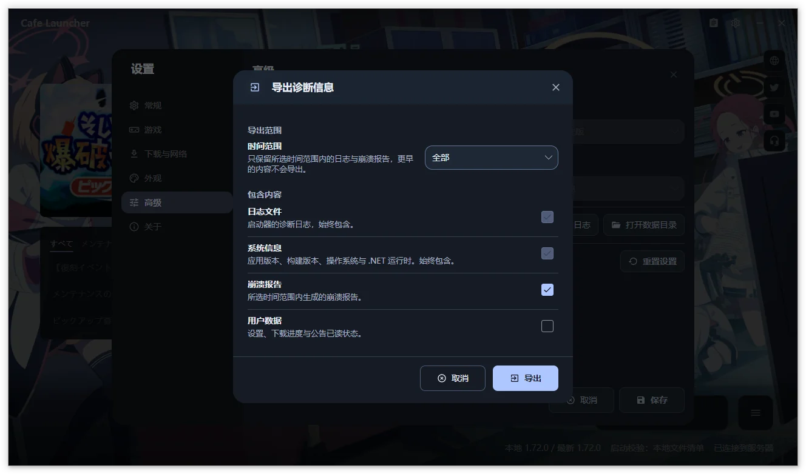

# 反馈指南  {#反馈指南}

请把“执行什么操作、实际发生什么、何时发生”写清楚，并附可复现步骤。启动器缺陷与建议在[源码仓库 Issues](https://github.com/bluearchive-cafe/Cafe.Launcher.Avalonia/issues)跟踪。

## 提交前  {#提交前}

1. 在“设置 → 关于”确认版本、提交信息，并检查更新。
2. 搜索[常见问题](/cafe-launcher/faq)与已有 Issues。
3. 记录问题发生时间和错误原文；安全时重试，确认复现频率。
4. 下载问题记录下载源、代理模式与目标磁盘；Linux 问题记录发行版、运行器、Proton 和 MangoHud 状态。
5. 视频背景问题记录格式、音量、静音、动态效果及窗口可见状态。

## 一份有效的反馈应包含  {#一份有效的反馈应包含}

复制下面的项目填写，步骤从明确的初始状态开始：

~~~text
标题：做了什么，发生了什么
启动器版本 / 提交 / 构建配置：
操作系统 / 架构：
游戏版本 / 后台任务：
相关下载源 / 代理 / 运行器：
复现步骤：
1.
2.
预期结果：
实际结果与完整错误：
发生时间 / 频率：
附件：截图、检查过的日志 ZIP
~~~

macOS 与 Linux 属于实验性平台，反馈时明确环境；macOS 暂不支持启动游戏。

## 导出日志  {#导出日志}

1. 打开“设置 → 高级”。如需更多细节，临时改为“调试”或“详细”，保存后复现。
2. 点击“导出日志”，选择全部、最近 1 小时、24 小时、7 天或 30 天。
3. 日志与系统信息始终包含；按需另选崩溃报告或用户数据，默认均不选。
4. 点击“导出”并选择本地保存位置，得到 `CafeLauncher_Logs_<时间戳>.zip`。
5. 检查内容后自行附到反馈，排障结束恢复原日志级别。

也可从日志查看器打开“导出日志”。取消或按 Esc 返回原查看器／设置入口，保留设置草稿；导出不会代替保存设置。

包内有当前与轮转日志、system-info.json；存在时还含最近运行器输出、前缀预检及元数据。Linux 会另采集相关进程快照，系统信息可能包含桌面会话、图形能力和 Proton 构建。导出不会自动上传，部分截图可能来自旧版。

> [!WARNING]
> 日志可能含路径或 UID。“用户数据”还包含设置、下载恢复记录与公告状态，按需选择并检查。不要公开分享 Cookie、密码或访问令牌。

## 截图与隐私  {#截图与隐私}

遮盖截图中的账号、UID、个人路径与通知。检查 ZIP 后再发送，不要直接上传完整用户数据目录；游戏崩溃日志与启动器日志分别用于不同问题。

不适合公开的材料可发至 <feedback@bluearchive.cafe>，注明相关 Issue。隐私处理见[隐私政策](https://github.com/bluearchive-cafe/Cafe.Launcher.Avalonia/blob/main/PRIVACY.md)。

## 提交位置  {#提交位置}

| 问题类型 | 入口 |
| --- | --- |
| 启动器缺陷、兼容问题、功能建议 | [GitHub Issues](https://github.com/bluearchive-cafe/Cafe.Launcher.Avalonia/issues) |
| 使用方法 | [文档首页](/cafe-launcher/)、[常见问题](/cafe-launcher/faq) |
| 汉化客户端自身问题 | [汉化客户端常见问题](/guide/qa) |
