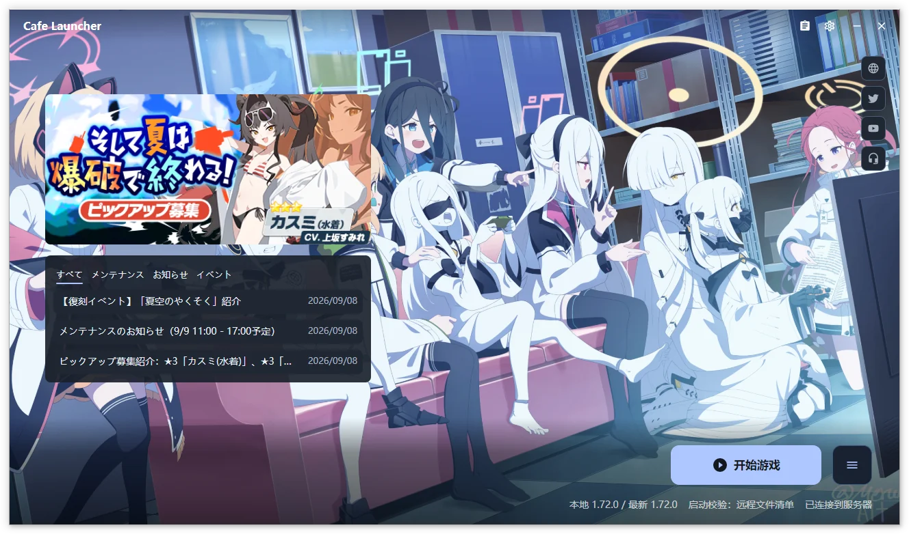

# Cafe Launcher

Cafe Launcher 帮助你安装和维护 Blue Archive 日服游戏。已有官方安装时，可以直接复用同一游戏目录；没有安装时，可以从这里下载、更新、修复并启动。

[下载发行包](https://github.com/bluearchive-cafe/Cafe.Launcher.Avalonia/releases) · [安装与首次使用](/cafe-launcher/installation) · [遇到问题](/cafe-launcher/faq)

> [!IMPORTANT]
> 本项目由社区维护，与 Nexon、Nexon Games、Yostar 及 Blue Archive 官方无隶属或合作关系。启动器不修改游戏进程，不向游戏注入代码。

截图用于操作示意，部分来自较早版本；当前入口和设置分组以正文为准。

## 从这里开始  {#从这里开始}

| 你的目标 | 阅读页面 |
| --- | --- |
| 下载启动器、识别已有游戏或首次安装 | [安装与首次使用](/cafe-launcher/installation) |
| 修改路径、网络、背景、配色与动态效果 | [设置参考](/cafe-launcher/settings) |
| 下载、修复、启动游戏或使用托盘 | [游戏操作](/cafe-launcher/operations) |
| 选择汉化资源、填写 UID | [资源面板](/cafe-launcher/resource-panel) |
| 删除游戏、启动器或本地数据 | [卸载与数据](/cafe-launcher/uninstall) |
| 排查故障、导出日志与提交反馈 | [常见问题](/cafe-launcher/faq)、[反馈指南](/cafe-launcher/feedback) |

## 主要能力  {#主要能力}

以下能力取决于平台。Windows 为正式支持平台，macOS 和 Linux 的限制见下方平台状态。

### 游戏管理  {#游戏管理}

安装、增量更新、修复、启动和卸载集中在主窗口。启动校验检查文件存在性与大小，修复使用 CRC64 检查文件内容。卸载游戏默认删除整个游戏目录，确认前会说明范围和路径。

### 下载与网络  {#下载与网络}

提供官方下载源与 Cafe 下载源、最多 10 个并发传输、限速、暂停与继续。正常退出会保留可恢复的下载任务；主动停止会放弃任务记录。代理与速度选项见[下载与网络设置](/cafe-launcher/settings#下载与网络)。

### 桌面体验  {#桌面体验}

支持 English、简体中文、繁體中文和日本語，系统/浅色/深色主题、背景取色、自定义图片，以及 Windows x64 本地视频背景。外观修改即时预览，可以保存或放弃。

提供系统托盘、本地日志查看与 ZIP 导出。Windows 可在应用内下载并校验启动器更新；macOS 和 Linux 从发布页手动安装。

### 汉化资源  {#汉化资源}

Cafe 下载源提供游戏文本、主线中配、图像视频三类汉化资源。使用八位大写字母组成的汉化 UID 在[资源面板](/cafe-launcher/resource-panel)单独开关；它与游戏内的数字 UID 不同。

## 平台状态  {#平台状态}

| 平台 | 架构 | 支持范围 |
| --- | --- | --- |
| Windows 10 1809+ / Windows 11 | x64 | 正式支持，含游戏启动、视频背景与应用内更新 |
| macOS | Apple Silicon | 实验性，可安装、更新和修复，暂不支持启动游戏 |
| Linux | x64 | 实验性，通过自行安装的 UMU / Proton 或 Wine 启动游戏 |

发行包包含 .NET Runtime，无需另行安装。Linux 反作弊兼容性取决于运行器、Proton、驱动和游戏版本；历史实机验证不代表所有组合均可运行。准备方法见[兼容运行环境](/cafe-launcher/settings#兼容运行环境-仅-linux)。

## 项目链接  {#项目链接}

- [源码与 Issues](https://github.com/bluearchive-cafe/Cafe.Launcher.Avalonia)
- [发行包与版本说明](https://github.com/bluearchive-cafe/Cafe.Launcher.Avalonia/releases)
- [隐私政策](https://github.com/bluearchive-cafe/Cafe.Launcher.Avalonia/blob/main/PRIVACY.md)
- [第三方许可](https://github.com/bluearchive-cafe/Cafe.Launcher.Avalonia/blob/main/THIRD-PARTY-NOTICES.md)
