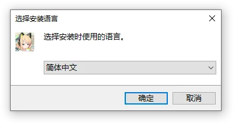
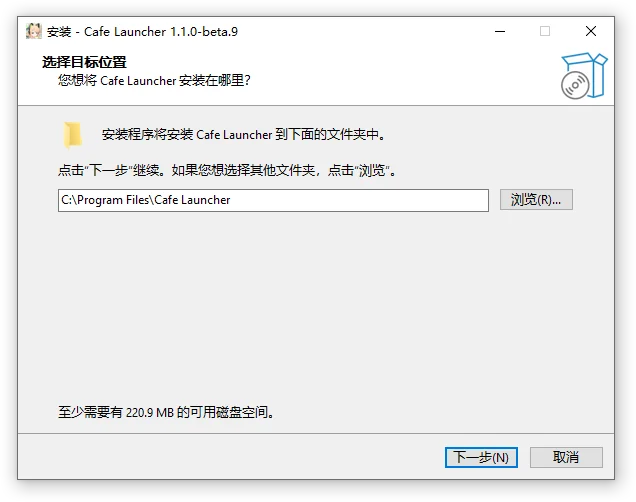
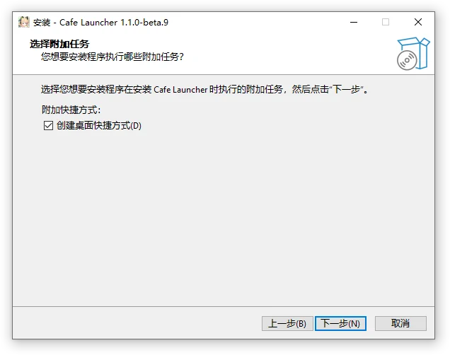
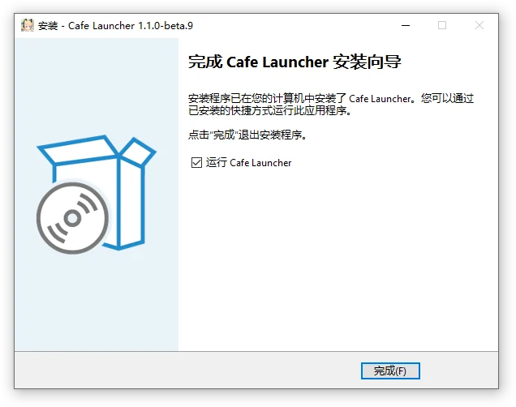
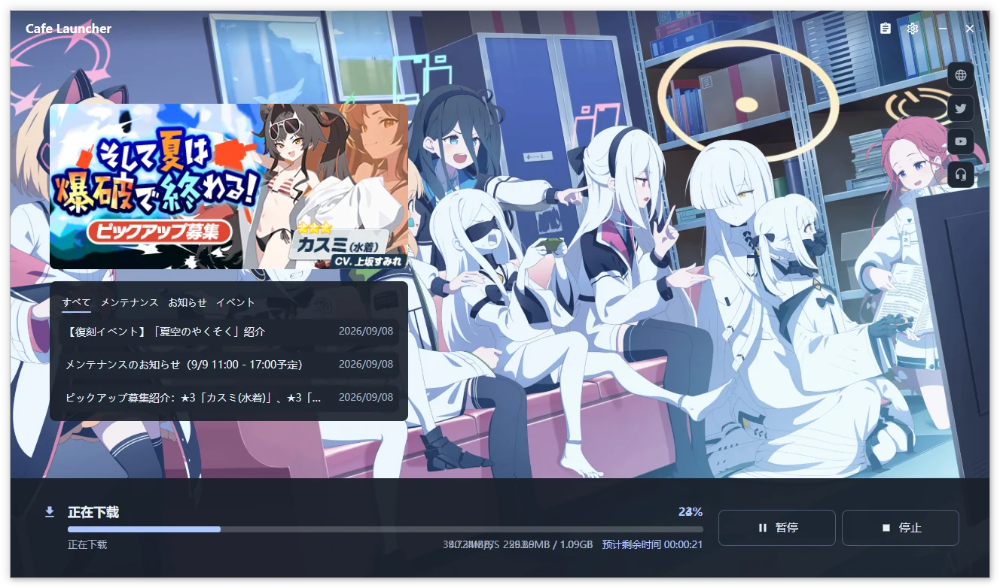

# 安装与首次使用  {#安装与首次使用}

按下面五步准备启动器并识别或安装游戏。只想复用已有游戏时，无需先卸载官方启动器。

## 1. 确认平台  {#_1-确认平台}

| 平台 | 可用发行包 |
| --- | --- |
| Windows 10 1809+ / Windows 11 x64 | 安装程序、便携 ZIP |
| macOS Apple Silicon | .app ZIP |
| Linux x64 | DEB、RPM、Arch 包、AppImage、tar.gz |

发行包自带 .NET Runtime。安装前确认游戏目标目录可写、磁盘空间充足，且网络可持续访问所选下载源。

> [!WARNING]
> macOS 与 Linux 为实验性构建。macOS 暂不支持启动游戏；Linux 需要另装 UMU / Proton 或 Wine，且不能保证反作弊在你的组合中可用。

## 2. 下载正确的文件  {#_2-下载正确的文件}

打开 [Releases](https://github.com/bluearchive-cafe/Cafe.Launcher.Avalonia/releases)，按平台选择完整发行包：

| 文件名 | 适用场景 |
| --- | --- |
| `Cafe.Launcher_v*_setup.exe` | Windows 标准安装 |
| `Cafe.Launcher_v*_win-x64.zip` | Windows 便携运行 |
| `Cafe.Launcher_v*_osx-arm64.zip` | Apple Silicon Mac |
| `Cafe.Launcher_v*_linux-x64.deb` | Debian、Ubuntu 等 |
| `Cafe.Launcher_v*_linux-x64.rpm` | Fedora、openSUSE 等 |
| `Cafe.Launcher_v*_linux-x64.pkg.tar.zst` | Arch Linux |
| `Cafe.Launcher_v*_linux-x64.AppImage` | Linux 免安装运行 |
| `Cafe.Launcher_v*_linux-x64.tar.gz` | Linux 手动解压 |

较早的发行包可能使用 `Cafe.Launcher.Avalonia` 前缀。日常使用选择最新稳定版；带 `beta` 等预发布标签的版本用于测试。

## 3. 安装启动器  {#_3-安装启动器}

选择与你下载的文件对应的方式。升级时先退出旧版本；程序文件、游戏目录和用户数据的位置彼此独立。

### Windows 安装版  {#windows-安装版}

1. 运行下载的安装程序并选择安装语言：English、简体中文或日本語。它只影响安装器，启动器语言在首次向导中设置。
2. 接受管理员权限提示，核对安装目录，默认是 `C:\Program Files\Cafe Launcher`。
3. 按需创建桌面快捷方式，完成后运行 Cafe Launcher。

安装、升级和卸载面向所有用户，需要管理员权限。覆盖安装保留独立的用户数据和游戏文件。

::: details 安装向导截图

:::

### Windows 便携版  {#windows-便携版}

完整解压 ZIP，再运行 `Cafe.Launcher.exe`；不要在压缩包预览窗口中启动。保留整个目录中的依赖和视频运行库。

便携版不创建标准卸载入口，设置和日志仍写入系统用户数据目录。它与安装版一样支持经校验的应用内更新；若需要手动替换，先退出，再替换完整程序目录。

### macOS

解压 `osx-arm64.zip`，将 Cafe Launcher.app 移到“应用程序”后运行，仅适用于 Apple Silicon。也可从同一发行版下载 `cafe-launcher.rb`，在已安装 Homebrew 的终端中执行 `brew install --cask ./cafe-launcher.rb`；Cask 会安装 mpv 依赖。ZIP 已包含视频运行库。

当前可安装、更新和修复游戏文件，暂不支持启动 Windows 游戏客户端。

### Linux

| 包类型 | 安装或运行方式 |
| --- | --- |
| DEB / RPM | 使用发行版对应的包管理器，自动安装 libmpv 依赖 |
| Arch 包 | `sudo pacman -U ./Cafe.Launcher_v<版本>_linux-x64.pkg.tar.zst`，替换为实际文件名 |
| AppImage | 赋予执行权限后运行 |
| tar.gz | 解压后运行 `Cafe.Launcher` |

通过系统包安装后可运行 `cafe-launcher`。Linux 便携版随包播放器需要 glibc 2.35 及支持 `GLIBCXX_3.4.29` 的 libstdc++；系统不满足时可使用兼容的系统 libmpv，否则视频会回退为静态背景。如窗口未出现，从终端启动并根据缺失库提示补齐系统图形、字体等依赖。

发行包不自动安装 Wine、UMU 或 Proton。启动游戏前请准备[兼容运行环境](/cafe-launcher/settings#兼容运行环境-仅-linux)。Linux 软件包和 AppImage 默认建议主目录下所选游戏的目录：蔚蓝档案为 `YostarGames/BlueArchive_JP`，星塔旅人为 `YostarGames/StellaSora_CN`。每款游戏首次安装时分别确认位置。

## 4. 完成首次设置  {#_4-完成首次设置}

| 步骤 | 要确认的内容 |
| --- | --- |
| 语言与主题 | 启动器界面语言，以及系统、浅色或深色主题 |
| 代理 | 自动检测、直连或系统代理 |
| 确认您的设置 | 复核并完成，也可返回修改任一步 |

首次向导只有这三步，只配置全局偏好，不选择游戏目录或下载源。游戏栏提供蔚蓝档案日服与星塔旅人国服；各游戏第一次点击“安装游戏”时再选择目录。蔚蓝档案在中文系统默认 Cafe 下载源，其他语言默认官方；星塔旅人只有官方下载源。稳定构建默认稳定更新通道，预发布构建默认测试通道。

选择“跳过引导”或按 Esc 会先要求确认，再应用默认设置。以后可以在设置中修改。

## 5. 识别或安装游戏  {#_5-识别或安装游戏}

先在游戏栏选择对应游戏。已有游戏时，使用该条目的“选择已安装游戏”或在“设置 → 游戏”选择现有目录：蔚蓝档案为 `BlueArchive_JP`，星塔旅人为 `StellaSora_CN`。启动器读取其中的 `manifest.json` 与 `game-launcher-config.json`；身份与格式有效时直接识别，无需重下完整游戏。文件不全时按当前清单补齐，不把另一款游戏的安装状态当作本游戏。

尚未安装时点击所选条目的“安装游戏”，按提示选择并保存这款游戏的安装目录，再等待下载与校验完成。取消目录选择不会开始任务。期间可以暂停和继续，也可切到另一条目查看后台任务摘要。

截图可能来自较早版本。后续操作见[游戏操作](/cafe-launcher/operations)，全部选项见[设置参考](/cafe-launcher/settings)。
