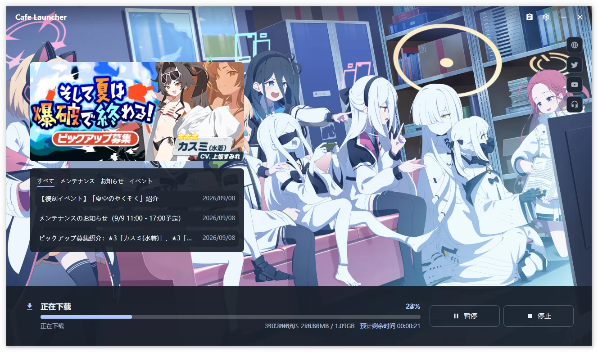
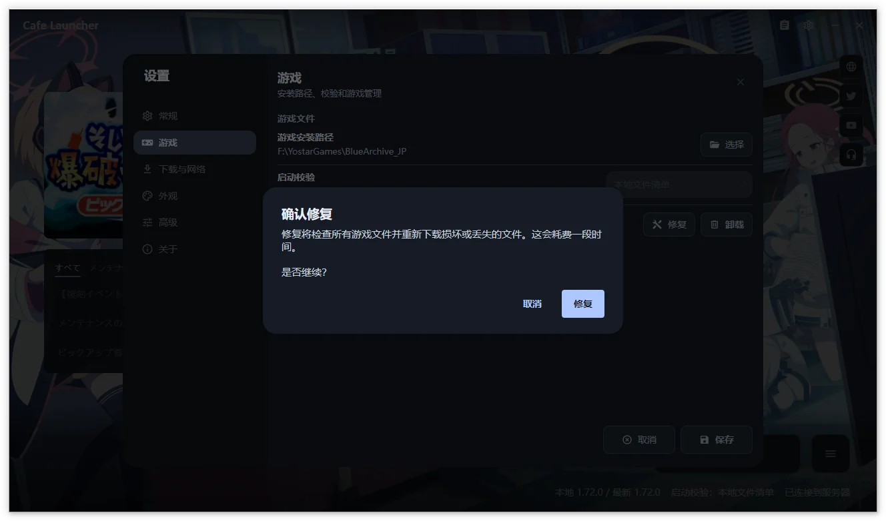
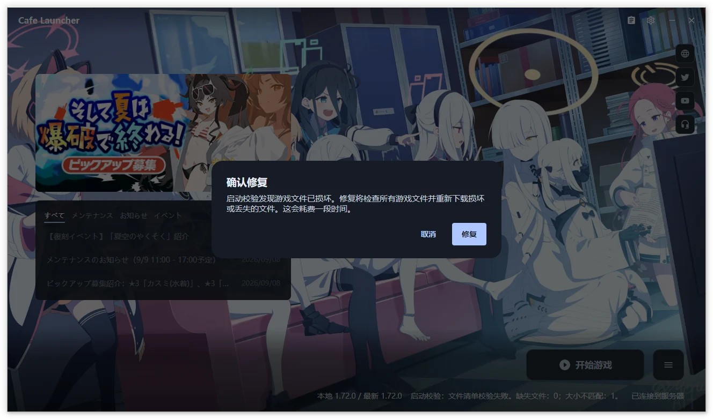
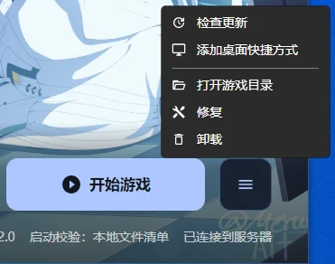
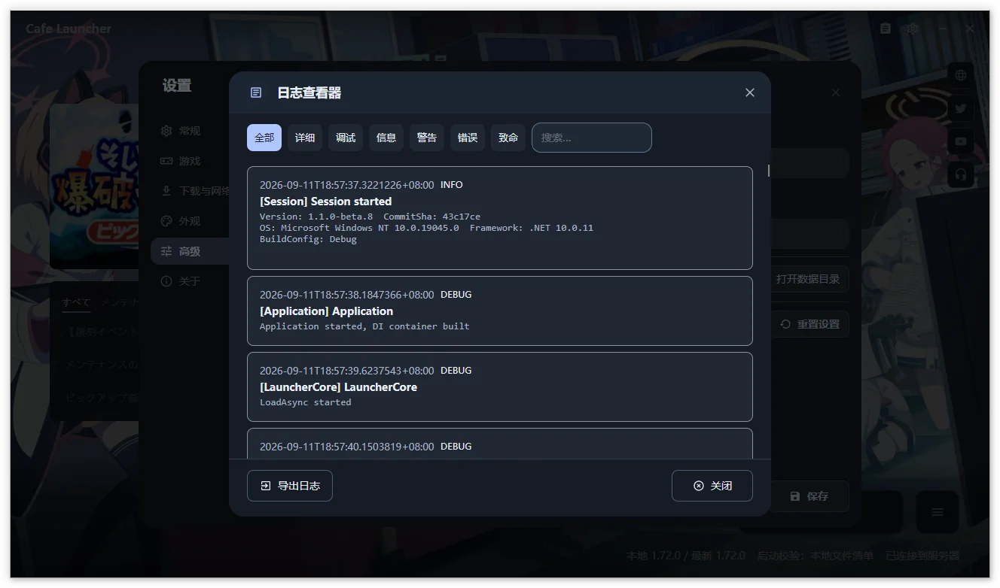
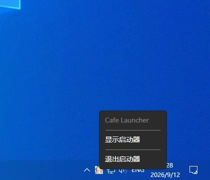

# 游戏操作  {#游戏操作}

主窗口根据安装与版本状态显示“安装游戏”“更新游戏”或“开始游戏”。操作进行时，底部同一区域显示进度与控制按钮；失败提示中的“查看日志”可直接进入排障入口。

## 安装与更新  {#安装与更新}

1. 点击“安装游戏”或“更新游戏”，启动器获取清单并计算需要下载的文件。
2. 等待下载，文件先写入 .tmp，支持续传时复用已有进度。
3. 文件经过 CRC64 校验后，更新本地清单与游戏配置。

进度区显示百分比、速度、大小和预计剩余时间，状态区显示当前下载源。

| 动作 | 结果 |
| --- | --- |
| 暂停 | 暂停传输，保留本次进度 |
| 继续 | 继续当前任务并复用可用临时文件 |
| 停止 | 经确认取消操作，放弃这次任务的恢复记录 |
| 正常退出 | 等待任务收尾并保留恢复记录，下次启动核对后恢复 |
| 限速 | 在[下载与网络设置](/cafe-launcher/settings#下载与网络)调整 |

“关窗并停止”属于主动停止。恢复要求游戏版本、清单、目录和下载源一致；不匹配时不会把旧任务套到新安装上。

空间预检会抵扣当前计划中可续传 .tmp 已占的字节，最终仍需校验。等待响应或连续读不到数据达到 60 秒时按网络失败重试；持续传输的大文件没有固定总时长限制。

## 修复  {#修复}

1. 先关闭游戏。
2. 在“设置 → 游戏”或[游戏操作菜单](#游戏操作菜单)选择“修复”。
3. 确认后等待远程清单的 CRC64 检查，重新下载缺失或不匹配文件。
4. 查看结果，失败时使用“查看日志”或按[反馈指南](/cafe-launcher/feedback)导出日志。

启动校验只检查存在性与大小，不能替代修复。切换下载源后，已安装游戏应按新下载源修复，使文件与清单一致。

## 启动游戏  {#启动游戏}

点击“开始游戏”，启动器先按所选模式校验，再启动本地安装状态指定的入口。默认成功后最小化到托盘，可在“设置 → 常规”修改。

| 会话状态 | 含义 |
| --- | --- |
| 游戏启动中 | 等待运行器启动并识别游戏 |
| 游戏运行中 | 已确认游戏进程 |
| 游戏已退出 | 会话结束，有可归属退出码时同时显示 |
| 启动失败 | 未成功进入运行态，恢复主窗口并显示错误 |

没有会话时状态行隐藏，正常退出只更新状态文案。Wine / Proton 不一定有可归属退出码；运行器早退或环境损坏可能导致启动失败。

文件缺失或大小不匹配时，启动前会提示修复：

Linux 依赖[兼容运行环境](/cafe-launcher/settings#兼容运行环境-仅-linux)，macOS 暂不支持启动游戏。

## 游戏操作菜单  {#游戏操作菜单}

游戏就绪时，点击“开始游戏”右侧的菜单入口。左侧主按钮仍直接启动；简略和隐藏状态面板布局都提供此入口。

| 操作 | 用途 |
| --- | --- |
| 检查更新 | 刷新远端游戏版本与主按钮状态 |
| 添加桌面快捷方式 | 为当前游戏入口创建快捷方式，仅 Windows 支持 |
| 打开游戏目录 | 在文件管理器中打开当前目录 |
| 修复 | 完整 CRC64 检查并补齐文件 |
| 卸载 | 删除整个游戏目录，需确认范围 |

这张截图来自旧版菜单，当前入口位于“开始游戏”右侧。

## 卸载游戏  {#卸载游戏}

关闭游戏后，在设置或游戏操作菜单选择“卸载”，核对完整路径、预计大小，以及是否额外清理受管兼容环境，再确认。

> [!WARNING]
> 默认删除整个游戏目录，包括游戏自行下载的资源和用户放入的文件，同时清理安装状态、恢复记录与桌面快捷方式。请先备份需要保留的内容。

卸载显示扫描、删除进度与结果，列出无法删除的项目。完成前保持启动器运行，可以最小化。自定义 Prefix 位于游戏目录和所选受管子树之外时保留。

启动器卸载与游戏卸载分别处理，见[卸载与数据](/cafe-launcher/uninstall)。

## 日志查看器  {#日志查看器}

打开“设置 → 高级 → 查看日志”，按级别浏览、搜索当前与轮转日志。

记录分批加载，搜索与级别筛选只作用于已加载内容。需要完整时间范围时，使用[导出日志](/cafe-launcher/feedback#导出日志)。

## 系统托盘  {#系统托盘}

关闭行为为“最小化到托盘”时，关闭按钮隐藏窗口，进程继续运行。托盘可显示主窗口、开始游戏、打开设置或彻底退出。

游戏启动中或运行中时，托盘启动项显示会话状态。需要确认框或设置页面时会恢复主窗口。再次运行启动器会唤醒已有实例；同一用户数据目录只允许一个实例，Linux 也跨登录会话判定。

本页截图可能来自旧版，按钮位置以正文为准。
