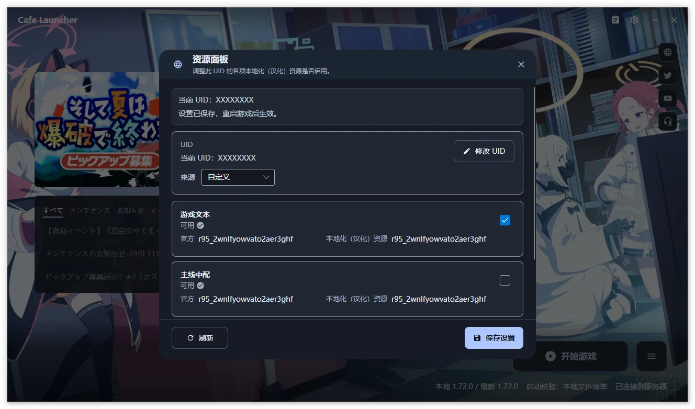

# 资源面板  {#资源面板}

资源面板仅为蔚蓝档案日服的汉化 UID 读取和保存服务端资源偏好。先选择蔚蓝档案条目，再点击标题栏齿轮左侧的剪贴板图标，或从“游戏设置 → 下载与资源”打开。设置入口会先处理未保存草稿并关闭编辑，再进入原资源流程。星塔旅人条目不提供 Cafe 下载源、汉化 UID 或此面板。

> [!IMPORTANT]
> 功能需要 Cafe 下载源。使用官方下载源时会提示切换；切换后请按提示[修复游戏](/cafe-launcher/operations#修复)，使文件与新清单一致。

## UID

使用**八位大写字母组成的汉化 UID**，不是游戏账号页面的纯数字 UID。例如格式为 `ABCDEFGH`。

| 来源 | 使用方式 |
| --- | --- |
| 自动获取（默认） | 读取本机游戏 Cookie Library；Windows 位于用户目录的 `AppData/LocalLow/YostarJP/BlueArchive/Cookies/Library`，Linux 从所选兼容前缀读取 |
| 自定义 | 手动填写 UID，之后通过“修改 UID”更新 |

读取不到时，填入面板输入框并点“保存 UID”。尚未生成时，先通过 Cafe 下载源启动游戏，再回来刷新；面板常驻说明首次生成条件。

UID 来源和手动 UID 保存在本机。读取仅用于找到对应 UID，不上传 Cookie 文件。

## 资源类别  {#资源类别}

| 类别 | 内容 |
| --- | --- |
| 游戏文本 | 剧情、界面、道具等中文文本 |
| 主线中配 | 主线剧情中文配音 |
| 图像视频 | 图像和视频汉化资源 |

各类有独立开关及官方/汉化资源版本。版本一致显示“可用”，不一致显示“待维护”，仍可勾选，但可能尚未适配当前版本。加载中时等待，获取失败时用“刷新”重试。

## 保存与生效  {#保存与生效}

1. 确认面板显示的是目标汉化 UID。
2. 切换资源开关。
3. 点击“保存设置”，等待顶部状态条确认成功。
4. 重启游戏使服务端偏好生效。

“刷新”重新读取服务端状态和版本。“保存设置”需要网络，将开关写入该 UID 的服务端配置，不直接修改本地游戏文件。取消某类开关并保存即可使用对应原始资源。

修改本地 UID 不会删除原 UID 的服务端配置。数据请求见[隐私政策](https://github.com/bluearchive-cafe/Cafe.Launcher.Avalonia/blob/main/PRIVACY.md)。截图仅供示意，可能来自旧版。
