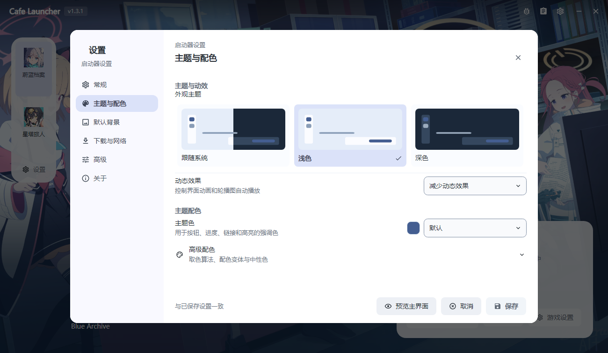
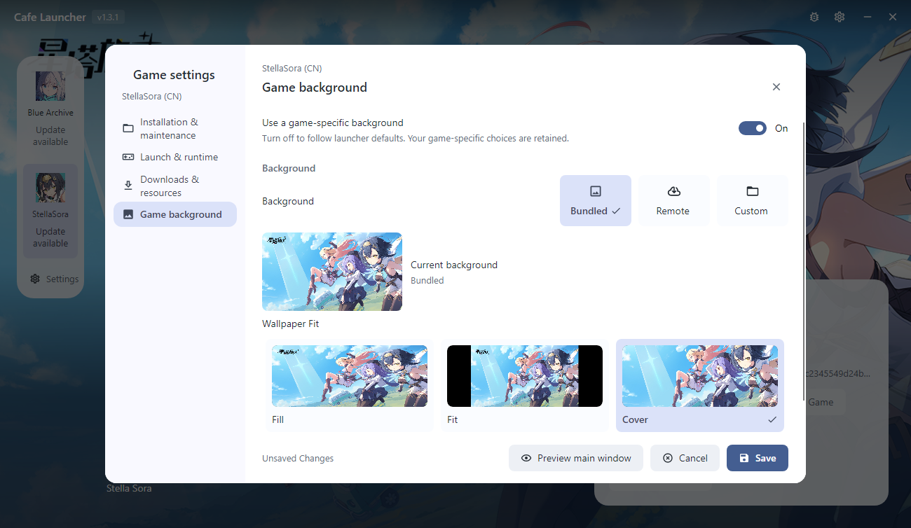
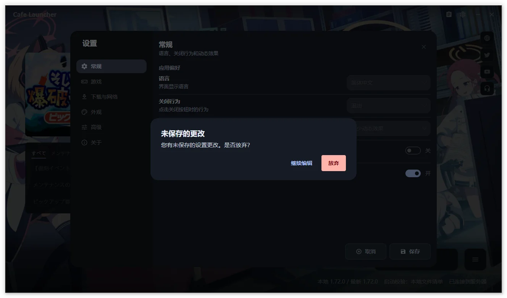
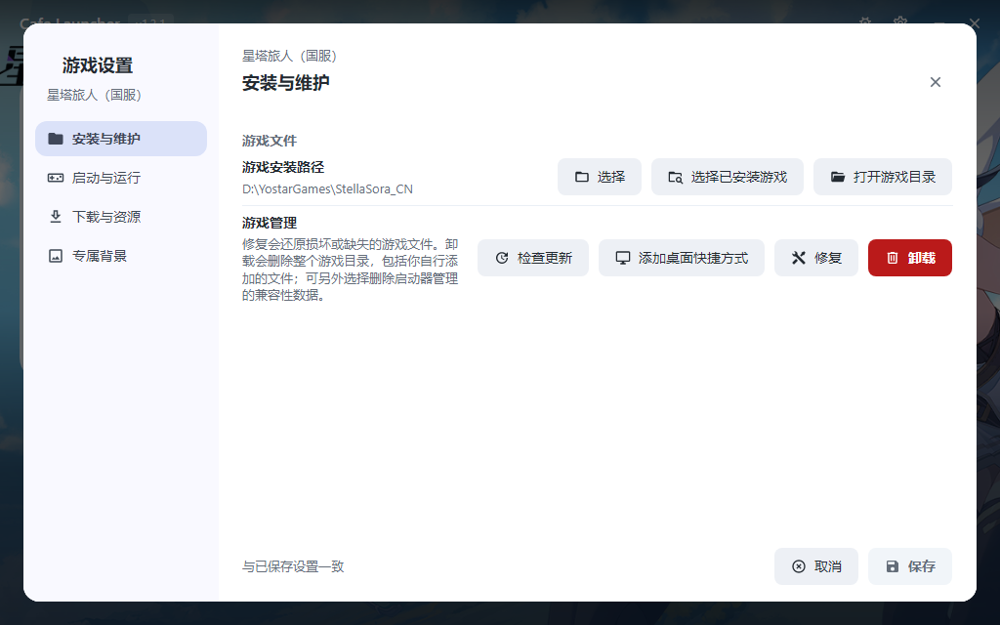

# 设置参考  {#设置参考}

从左侧悬浮游戏栏底部的齿轮进入“启动器设置”，分为常规、主题与配色、默认背景、下载与网络、高级、关于六类。游戏操作卡或“开始游戏”旁菜单中的“游戏设置”打开独立对话框，分为安装与维护、启动与运行、下载与资源、游戏背景四类；标题会标出目标游戏。

修改保留为草稿；外观会即时预览，保存后才持久化，放弃时恢复。带改动关闭设置或按 Esc 会询问是否放弃。重置设置、主窗口即时路径操作与资源面板保存分别执行，见对应说明。

游戏设置固定为打开时所选条目；目录、下载源、启动校验、运行环境、启动后行为、适用的汉化 UID 和背景专属覆盖分游戏保存。语言、主题配色、动效、代理、HTTP/2、限速和启动器更新偏好共用。保存只提交当前对话框范围的修改，先保存或放弃再切换游戏。

文件任务进行期间，所属游戏的目录、下载源、运行环境等游戏设置会锁定。背景专属覆盖、其他游戏与全局偏好仍可保存；暂停不会解除操作配置的锁定。

设置截图展示简体中文与英文；其他截图可能来自旧版，当前入口以正文为准。

## 常规  {#常规}

设置应用偏好、主界面显示与启动器更新。动态效果位于[外观](#主题与动效)。

### 应用偏好  {#应用偏好}

| 设置 | 可选值 | 说明 |
| --- | --- | --- |
| 语言 | 自动（跟随系统语言）、English、简体中文、繁體中文、日本語 | 界面显示语言 |
| 关闭行为 | 最小化到托盘、退出 | 点击关闭按钮时的行为 |
| 记忆窗口位置和大小 | 开、关 | 启动时恢复启动器窗口的位置和大小 |

关闭行为与游戏启动后行为是两个独立选项，均默认最小化到托盘。记忆窗口位置和大小默认关闭。

### 显示  {#显示}

| 设置 | 可选值 | 说明 |
| --- | --- | --- |
| 状态面板 | 不显示、简略 | 控制底部状态区域的显示和详细程度 |
| 远程内容卡片 | 开、关 | 在主界面显示公告与横幅；加载失败时卡片上会就地提供“重试”按钮 |

默认使用简略状态面板并显示远程内容卡片。卡片开关对所有游戏生效，保存后切换到已查看的游戏也会保持该选择。远程内容加载失败时可在卡片上重试。

### 更新  {#更新}

| 设置 | 可选值 | 说明 |
| --- | --- | --- |
| 启动时检查更新 | 开、关 | 初始化完成后在后台检查所选更新通道 |
| 更新通道 | 稳定版、测试版 | 决定启动器自身更新是否包含预发布版本 |

启动时检查默认开启；稳定构建默认稳定通道，预发布构建默认测试通道。通道只影响启动器自身更新，游戏更新仍按游戏版本判定。

Toast 始终启用，没有单独开关；停留时长按类型固定，指针悬停时暂停计时。

## 游戏  {#游戏}

以下选项位于独立“游戏设置”。目录与管理操作在“安装与维护”，启动校验、运行环境与启动后行为在“启动与运行”，下载源与适用资源入口在“下载与资源”。维护动作会先要求处理未保存草稿。

| 设置 | 可选值 | 说明 |
| --- | --- | --- |
| 游戏安装路径 | 本地目录 | 蔚蓝档案规范化为 `YostarGames/BlueArchive_JP`，星塔旅人为 `YostarGames/StellaSora_CN`；路径旁的“打开游戏目录”打开此目标目录 |
| 启动校验 | 本地文件清单、远程文件清单、无 | 启动游戏前如何检查文件完整性 |
| 游戏启动后的行为 | 保持窗口打开、最小化到托盘、退出启动器 | 当前设置目标游戏成功启动后的动作，分游戏保存 |
| 游戏管理 | 检查更新、添加桌面快捷方式、修复、卸载 | 对固定目标游戏执行相应操作；卸载默认删除整个游戏目录，可选同时删除启动器管理的兼容环境 |

路径旁的“选择”只修改草稿，保存后才生效。“选择已安装游戏”用于识别已有安装，校验成功后立即保存并刷新状态，设置页和主窗口入口行为相同。主窗口“更改路径”也立即保存。

“选择已安装游戏”“打开游戏目录”和游戏管理动作会先结束设置编辑：有草稿时可继续编辑并取消本次操作，或放弃改动后继续原目标流程；无改动时直接关闭设置并继续。修复确认与卸载弹窗均显示目标游戏名称。

此图为正式界面在小窗口中的渲染，目录为演示值。

“更改路径”可选择基础目录，启动器会补齐当前游戏的子目录，并校验最终目录。基础目录里其他程序的同名清单不会被当成游戏损坏；最终目录尚未安装或安装状态不完整时仍接受选择（安装会重建状态，修复会重写状态），读取因 I/O 或权限失败时提示无法读取安装状态；最终目录属于其他游戏或与另一安装重叠时仍会拒绝。

“选择已安装游戏”用于导入已有游戏；若目录尚未安装，会提示“游戏尚未安装”，不会保存新路径。首次安装请用“更改路径”：例如星塔旅人选择 `G:\YostarGames` 后，目标为 `G:\YostarGames\StellaSora_CN`。

修复与卸载的范围见[游戏操作](/cafe-launcher/operations)。卸载默认包含清单外文件，确认前核对完整路径。

### 启动校验模式  {#启动校验模式}

| 模式 | 行为 | 适用情况 |
| --- | --- | --- |
| 本地文件清单 | 使用本地 `manifest.json` 检查文件存在性与大小 | 默认模式，速度最快 |
| 远程文件清单 | 获取远程清单后检查文件存在性与大小 | 怀疑本地清单过期或损坏 |
| 无 | 直接尝试启动，状态面板显示“已禁用” | 临时绕过校验问题 |

默认本地文件清单。两种清单模式都检查存在性和大小，文件内容损坏应使用 CRC64 修复。远端清单不可用时，启动校验会放行；这不代表文件已通过完整性检查。

### 兼容运行环境（仅 Linux）  {#兼容运行环境-仅-linux}

| 设置 | 说明 |
| --- | --- |
| 运行环境 | 选择启动 Windows 游戏客户端的方式，可选自动、Windows（原生）、UMU / Proton（实验性）、Wine（实验性）；Linux 选项均为实验性，XIGNCODE3 反作弊已在特定组合（Arch + UMU 1.4.4 + UMU-Proton 10.0-4 + NTFS3）上实机验证，其他组合尚未验证 |
| 运行器路径 | 自定义 `umu-run` 或 `wine` 可执行文件，留空自动检测 |
| Prefix 路径 | 留空由 Cafe Launcher 按运行器管理相互隔离的 Prefix |
| Proton 路径 | 自定义 UMU 使用的 Proton 版本，留空由 UMU 自动选择 |
| MangoHud | 默认关闭；开启后为 Wine / UMU 启动的游戏启用 Vulkan / DXVK 性能叠层，需要自行安装 MangoHud；仅 Linux 显示 |
| 运行环境状态 | 只读，显示当前运行环境的检测结果（可用、无法运行、未找到等） |

运行环境默认自动选择。兼容运行层需自行安装；前缀留空时按运行器使用独立受管目录。启动前会检查可写性、挂载执行权限与符号链接支持等条件，失败时给出建议。

历史实机记录包含 Arch Linux + UMU 1.4.4 + UMU-Proton 10.0-4 + NTFS3 游戏目录。它是特定组合的验证，不能保证其他组合或后续反作弊版本可用。

这项历史记录针对蔚蓝档案，不能据此推定星塔旅人的反作弊在同一环境可用。两款游戏分别保存运行器、Prefix、Proton 与 MangoHud 选择。

MangoHud 默认关闭，需要自行安装 Vulkan 层；仅影响 Linux Wine / UMU 游戏子进程，覆盖 Vulkan / DXVK，不自动安装或提供 OpenGL 注入。

## 下载与网络  {#下载与网络}

代理、HTTP/2 与限速位于启动器设置；下表中的分游戏下载源位于“游戏设置 → 下载与资源”。

| 设置 | 可选值 | 说明 |
| --- | --- | --- |
| 代理 | 自动检测系统代理、直连（不使用代理）、系统代理（优先使用显式配置） | 游戏下载、更新检查、远程图片等启动器网络请求使用的代理 |
| 启用 HTTP/2 | 开、关 | 新请求优先使用 HTTP/2；不可用时自动回退到 HTTP/1.1 |
| 下载源 | 蔚蓝档案：官方、Cafe；星塔旅人：官方 | 只修改当前游戏条目的补丁服务器 |
| 下载速度限制 | 无限制、1、5、10、25、50 MB/s | 限制下载速度，降低网络影响 |

默认自动检测系统代理、启用 HTTP/2、下载不限速。蔚蓝档案在中文系统首次选择 Cafe 下载源，其他语言环境选择官方；星塔旅人始终只提供官方源。Cafe 汉化资源与资源面板仅适用于蔚蓝档案。

| 代理模式 | 行为 |
| --- | --- |
| 自动检测系统代理 | 使用运行时的系统代理检测 |
| 直连（不使用代理） | 明确绕过所有代理 |
| 系统代理（优先使用显式配置） | 优先系统显式代理，未配置时回退自动检测；Linux 读取 GNOME 设置 |

已保存的代理和 HTTP/2 偏好用于后续取得的网络客户端，手动检查更新也读取已保存值。切换下载源后按提示修复，以匹配新清单。下载失败后换源并保存，再点击原任务的“重试”，会使用该游戏的最新状态和对应下载源。

Clash / mihomo 使用 Fake-IP 时，直连解析到 IPv4 `198.18.0.0/15` 或 IPv6 `fc00::/7` 不会仅因此被拒绝；若仍连接失败，可切回自动代理，或核对代理软件的 TUN / Fake-IP 设置。

## 外观  {#外观}

“主题与配色”包含主题、动效与配色；背景默认规则位于独立“默认背景”页。主题缩略卡可比较明暗，适配卡使用当前背景展示三种构图。设置页脚显示当前范围是否有未保存改动，标题、关闭和保存区始终可达；大字号下操作可换行。主题与来源可直接点击选项卡选择，高级配色默认折叠。更改即时预览，保存才落盘；放弃恢复背景、配色、动效、音量与静音。

点击“预览主界面”暂时收起设置；后台任务继续，游戏操作与切换仍受限制。点击“返回设置”或按 Esc 回到原分类和焦点。全局默认背景的临时预览会显示说明，结束后恢复该游戏的有效背景；即使把全部修改改回原值后直接关闭设置，也会恢复。

### 主题与动效  {#主题与动效}

| 设置 | 可选值 | 说明 |
| --- | --- | --- |
| 外观主题 | 跟随系统、浅色、深色 | 跟随系统，或固定为浅色/深色外观 |
| 动态效果 | 跟随系统、完整动态效果、减少动态效果 | 控制界面动画、轮播图自动播放及视频背景播放；减少动态效果时视频改为首帧静帧；此项已从“常规”移到这里 |

默认跟随系统主题与动画偏好。完整动态效果按启动器内的明确选择启用；减少动态效果会停止空间移动、轮播自动播放和视频播放，视频背景改为显示首帧静帧。

### 背景  {#背景}

在“启动器设置 → 默认背景”定义默认来源与适配规则，进入该页会预览默认背景，切换到其他分类时恢复当前游戏的有效背景；这些预览不会自动保存。保存会结束临时预览；需要时可再次点击“预览主界面”查看默认规则。每个游戏使用自己的内置图或远程壁纸。“游戏设置 → 游戏背景”可开启“使用专属背景”，整组覆盖此游戏的来源、适配和媒体选项。自定义图片、视频和文件夹仅在专属覆盖中提供；关闭覆盖保留原选择，再启用可恢复。其他游戏不受影响。

加载失败先显示当前游戏内置图，内置图也不可用时才使用通用背景；警示保留原因，原配置不会被替换。旧版本全局自定义背景会迁入两款游戏的专属配置，共用原文件路径；迁移前保留原始设置备份。

| 设置 | 可选值 | 说明 |
| --- | --- | --- |
| 背景 | 全局：内置默认、远程；游戏专属：另含自定义 | 启动器背景来源；自定义支持图片和本地视频 |
| 当前背景 | 来源名称、文件路径和缩略图 | 内置和远程显示来源名称；远程地址可悬停查看，自定义显示本次实际选中的文件 |
| 自定义背景 | 选择图片或视频、选择文件夹、清除 | 仅在背景为“自定义”时出现；文件夹每次刷新随机选择一个支持的文件，不扫描子文件夹 |
| 壁纸适配方式 | 拉伸填充、适应、覆盖 | 图片或视频在窗口中的适配方式 |
| 壁纸背景色 | 自定义颜色 | 仅在“适应”模式下显示，用于填充背景周围的空白 |
| 视频背景音量 | 0–100%，默认 0 | 选中视频时显示；“静音”保留音量设置，取消静音后恢复该音量 |

默认内置背景。图片支持 .png、.jpg、.jpeg、.bmp、.webp，视频支持 .mp4、.mkv、.webm。文件夹模式只随机选择当前层的支持文件；音量、静音、适配或窗口尺寸改变不会重新随机。

Windows x64、Linux x64 和 macOS Apple Silicon 支持视频背景；便携包包含运行库，Linux 系统安装包使用包管理器安装依赖。播放失败时显示内置静态回退并提示；首帧就绪前保留静态背景。最小化、隐藏到托盘时暂停，恢复可见后继续；减少动态效果时暂停并显示首帧静帧，恢复允许动效后继续播放。音量默认 0，静音默认关闭；静音期间可继续调节保留的音量。

缩略图优先使用 MP4 内嵌封面，否则取首帧，附带视频标记。背景取色使用原始封面或首帧，不随播放逐帧变化。媒体只在本机读取，不上传；内置作品来源见“关于”。

### 主题配色  {#主题配色}

| 设置 | 可选值 | 说明 |
| --- | --- | --- |
| 主题色 | 默认、跟随系统、从壁纸获取、自定义 | 用于按钮、进度、链接和高亮的强调色 |
| 壁纸色板 | 从当前背景提取 | 仅在“从壁纸获取”时出现；选择颜色作为主题种子色，可手动刷新色板 |
| 自定义主题色 | 自定义颜色 | 仅在主题色为“自定义”时出现 |

默认使用项目主题色。壁纸色板只有在“从壁纸获取”时出现，自定义颜色只在“自定义”时出现。色板来自当前图片或视频封面/首帧，可以选择种子色或手动刷新。

### 高级配色  {#高级配色}

默认折叠，展开后按需调整：

| 设置 | 可选值 | 说明 |
| --- | --- | --- |
| 取色算法 | M3 Celebi + Score、Wu、Wsmeans、Octree（旧版） | 仅在主题色为“从壁纸获取”时出现 |
| 配色变体 | TonalSpot、Vibrant、Expressive、Content、Fidelity、Neutral、Rainbow、Monochrome | 生成 M3 配色方案时使用的风格 |
| 中性色 | 默认、跟随主题色 | 使用默认中性色，或根据当前主题色生成中性色 |

默认 M3 Celebi + Score、TonalSpot 与默认中性色。展开/收起只改变本次界面状态，不会产生设置改动。

## 高级  {#高级}

用于查看和导出诊断信息，或重置设置。

### 诊断  {#诊断}

| 设置 | 可选值 | 说明 |
| --- | --- | --- |
| 日志级别 | 详细、调试、信息、警告、错误、致命 | 控制诊断日志的详细程度 |
| 日志文件 | 查看日志、导出日志、打开数据目录 | 查看、导出或打开日志所在目录 |

发行构建默认“信息”。需要时临时提高到“调试”或“详细”，保存、复现问题，再导出，完成后恢复原级别。

[日志查看器](/cafe-launcher/operations#日志查看器)只筛选已加载记录；[导出日志](/cafe-launcher/feedback#导出日志)可按时间范围创建本地 ZIP，不会自动上传。“打开数据目录”可确认实际存储位置。

查看日志和导出日志可覆盖在设置上，不丢弃草稿。从查看器打开导出后，按 Esc 先返回查看器，再返回设置的原入口；有设置改动时，继续关闭设置仍会询问是否放弃。

### 重置设置  {#重置设置}

> [!WARNING]
> “重置设置”立即恢复全部启动器设置，无需再点击“保存”，且不能撤销。执行前确认不再需要当前配置。

如果正在排障，先导出所需记录。重置不等于卸载游戏；删除范围见[卸载与数据](/cafe-launcher/uninstall)。

## 关于  {#关于}

显示应用版本、提交、构建配置、.NET、Avalonia 与平台信息。可检查启动器更新、打开官网和帮助文档，并访问源码、发行仓库、问题反馈、隐私政策、壁纸来源与免责声明。

手动检查使用已保存的通道和代理。Windows 更新流程为：阅读发布说明 → 下载 → 按同一版本 SHA256SUMS 校验 → 重启以更新，由独立助手应用安装或便携包。

更新弹窗打开时保留下层设置草稿；取消或按 Esc 返回“关于”的检查入口。启动器更新是全局操作，与游戏设置中的游戏更新检查分别处理。

有未保存设置、设置正在保存或任一游戏文件任务仍未收尾时，不能“重启以更新”。先处理草稿并完成或停止任务，再重试；暂停也仍算活动任务。

缺少可校验包、摘要或更新助手时，对话框说明原因并提供“前往发布页”；macOS、Linux 始终使用该入口手动安装。发布说明支持远程图片和链接，图片失败不阻碍正文或更新操作。

更新弹窗保留最小尺寸，避免短说明或状态提示使内容区过小。更新说明正在获取时，弹窗显示加载提示；正文未能加载时，可继续更新或点击“前往发布页”查看。图片有独立的加载与失败提示，部分图片失败时仍可阅读正文并继续更新。
