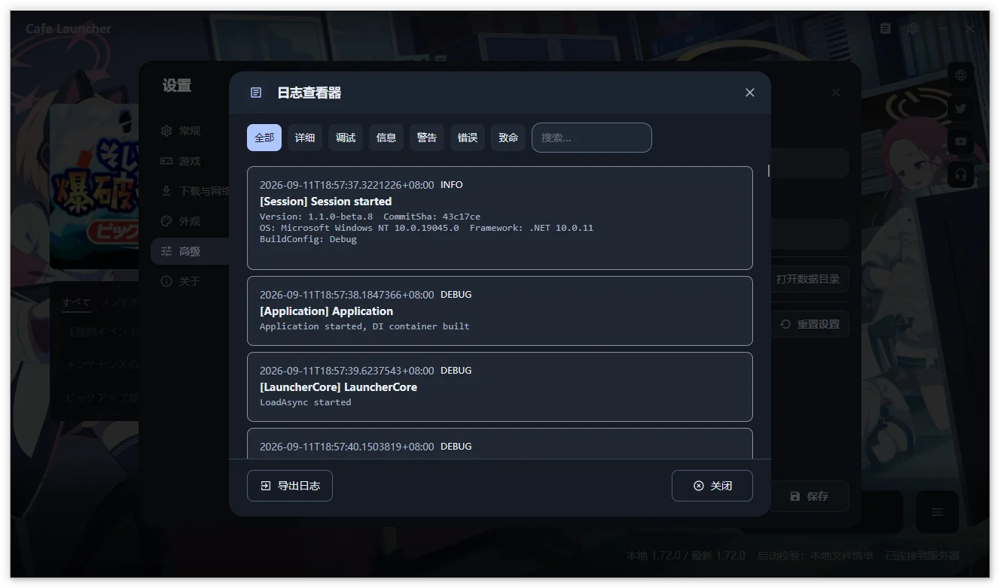
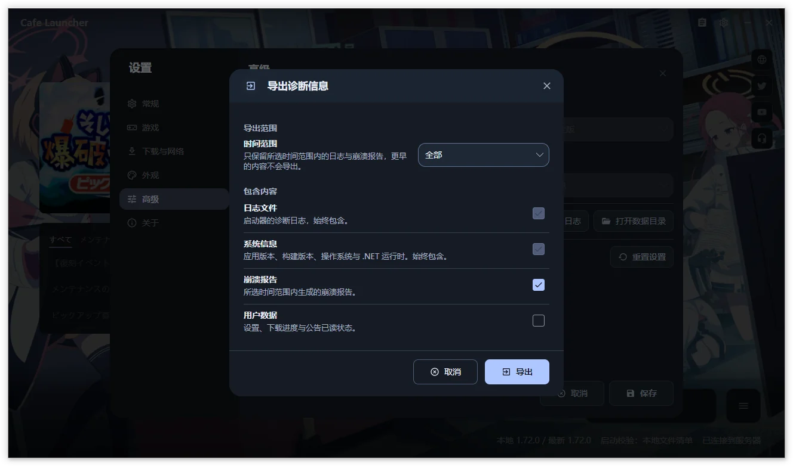

# Frequently Asked Questions <span id="常见问题"></span> {#frequently-asked-questions}

## Which package should I download? <span id="应该下载哪个文件"></span> {#which-package-should-i-download}

On Windows, use `setup.exe` unless you need the portable `win-x64.zip`. Apple Silicon Macs use `osx-arm64.zip`. On Linux, choose `.deb`, `.rpm`, AppImage, or `.tar.gz` as appropriate for your distribution.

Versions containing `beta` are prereleases. See [Installation and First Run](/en/cafe-launcher/installation) for the full package list.

## v1.1.0-beta.5 crashes at startup <span id="v1-1-0-beta-5-启动器无法启动-启动即崩溃"></span> {#v1-1-0-beta-5-crashes-at-startup}

The first beta.5 builds could close immediately or show no window, with this error in the log:

```text
System.InvalidOperationException: NoServiceRegistered, Cafe.Launcher.Avalonia.Services.WindowFilePickerService
```

Those builds preceded a fix for a missing service registration. This was a packaging issue unrelated to antivirus, the game directory, or your system configuration.

Beta.5 was fixed and republished. Download it again, or install a newer release from the [release page](https://github.com/bluearchive-cafe/Cafe.Launcher.Avalonia/releases). Reinstalling preserves settings because they are stored separately.

To identify the affected build, check `CommitSha` near the start of the log: `b33915d` is affected; fixed builds use a later commit.

## Can I reuse files downloaded by the official launcher? <span id="可以复用官方启动器下载的游戏吗"></span> {#can-i-reuse-files-downloaded-by-the-official-launcher}

Yes. Select the existing `BlueArchive_JP` directory in the setup wizard or Settings → Game. Cafe Launcher reads its `manifest.json` and `game-launcher-config.json`.

Do not run both launchers at once or let one modify files while the other downloads, updates, or repairs them.

## Downloads are slow <span id="下载速度很慢"></span> {#downloads-are-slow}

Check these in order:

1. Set the download speed limit to Unlimited in Settings → Download & Network.
2. Try the other source, Official or Cafe.
3. Check that the proxy mode matches your network.
4. Check free disk space and disk write performance.
5. Pause and continue, or restart the launcher to resume the saved task.

After changing sources, repair an installed game to match the new resources.

## Downloads fail, verification fails, or retries keep repeating <span id="下载失败、校验失败或反复重试"></span> {#downloads-fail-verification-fails-or-retries-keep-repeating}

- Close the game.
- Check that the directory exists, is writable, and has enough space.
- Check whether security software blocks `.tmp` files or writes to the game directory.
- Try the other source and repair again.
- If the issue persists, increase the log level, reproduce it, and export logs.

Avoid deleting individual temporary files while a task is active. Stop the operation first and let the launcher manage its task state.

## The launcher says the game is running <span id="启动器提示-游戏正在运行"></span> {#the-launcher-says-the-game-is-running}

Close the game before proceeding. If its window is gone, check Task Manager for remaining `BlueArchive.exe` or `xldr_BlueArchiveOnline_JP_loader_x64.exe` processes.

On Linux, the launcher recognizes games it started and also checks externally started processes using the installation directory. If scanning times out and it cannot establish the game state, close the game and retry.

## Launch verification reports missing files or size mismatches <span id="启动时提示文件缺失或大小不一致"></span> {#launch-verification-reports-missing-files-or-size-mismatches}

Use Repair in Settings → Game. Selecting a remote manifest only changes the verification reference; it does not repair files automatically. None is useful only for temporarily isolating verification problems.

## How do Official and Cafe sources differ? <span id="官方下载源与-cafe-下载源有什么区别"></span> {#how-do-official-and-cafe-sources-differ}

| Source | Contents | When to use it |
| --- | --- | --- |
| Official | Original Yostar game resources | Keep original JP resources |
| Cafe | Chinese localization resources from the BlueArchive.Cafe JP localization team | Use Chinese resources or try an alternative download server |

Chinese system locales default to Cafe; other locales default to Official. Either can be changed in Settings. The launcher's English interface is available with both sources.

## Settings changes did not take effect <span id="修改设置后没有生效"></span> {#settings-changes-did-not-take-effect}

Most settings require Save after editing. Cancel or discarding changes closes the draft without applying it.

Main-window path selection and installed-game detection save immediately. The path picker inside Settings remains a draft until saved.

## How does the launcher update itself? <span id="启动器如何更新"></span> {#how-does-the-launcher-update-itself}

By default, it checks the selected channel after initialization. You can also check manually in Settings → About.

Windows installer and portable builds support in-app updates: preview the release notes, choose **Download**, then **Restart to Update** after SHA-256 verification. The launcher exits, applies the package, and reopens. If the required package or checksum list is missing, it opens the release page instead of executing an unverified file.

On macOS and Linux, **Go to Release Page** opens your browser; download and install the update manually.

A failed startup update check does not prevent using the launcher. Beta includes prereleases; Stable tracks stable releases only.

## Can Linux launch the game? <span id="linux-能直接运行游戏吗"></span> {#can-linux-launch-the-game}

Experimental Linux x64 builds support automatic runtime selection, UMU / Proton, and Wine. The full chain including XIGNCODE3 was verified on Arch Linux + UMU 1.4.4 + UMU-Proton 10.0-4 with the game on NTFS3. Other distributions, Proton builds, and graphics drivers have not been verified and may not work.

## Can the macOS launcher launch the game? <span id="macos-能启动游戏吗"></span> {#can-the-macos-launcher-launch-the-game}

No. It installs, updates, and repairs game files, but does not provide a compatibility layer for the Windows game. Game launch support is not currently planned. Use Windows for supported game launch.

## How do I view or export logs? <span id="如何查看或导出日志"></span> {#how-do-i-view-or-export-logs}

Open Settings → Advanced:

- **View Log** browses, searches, and filters loaded records.

  

- **Export Logs** lets you choose a time range and contents for a diagnostics ZIP.

  

- **Open Data Directory** locates the log files.

Include your version, reproduction steps, screenshots, and log ZIP when reporting an issue. Review logs for private paths or other environment information first. See the [Feedback Guide](/en/cafe-launcher/feedback#export-logs).

## How do I remove everything? <span id="如何彻底卸载"></span> {#how-do-i-remove-everything}

The launcher application, user data, and game directory are independent. Follow [Uninstall and Data](/en/cafe-launcher/uninstall) to clean them up. Game uninstall deletes the whole game directory, including your own files; launcher uninstall keeps it.

## I still need help <span id="仍然无法解决"></span> {#i-still-need-help}

Collect information using the [Feedback Guide](/en/cafe-launcher/feedback) and report it in [Cafe Launcher Issues](https://github.com/bluearchive-cafe/Cafe.Launcher.Avalonia/issues).
