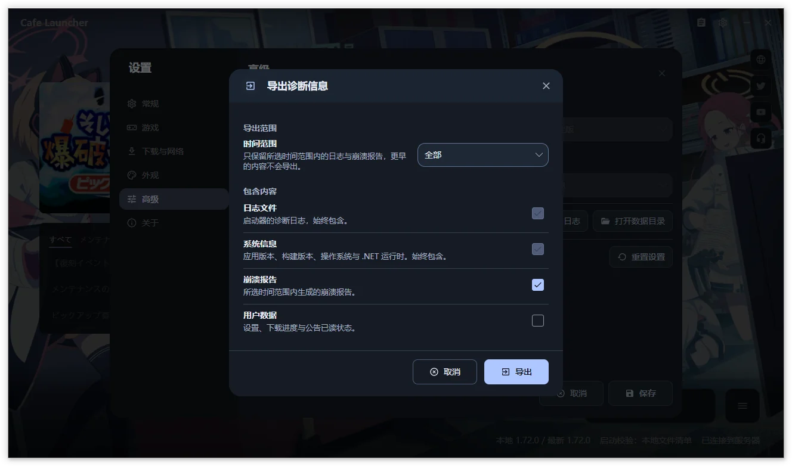

# Feedback Guide  {#feedback-guide}

Describe the action, actual result, and occurrence time, with reproducible steps. Launcher bugs and suggestions are tracked in the [source repository Issues](https://github.com/bluearchive-cafe/Cafe.Launcher.Avalonia/issues).

## Before reporting  {#before-reporting}

1. Check version, commit, and available updates under Settings → About.
2. Search the [FAQ](/en/cafe-launcher/faq) and existing Issues.
3. Record the time and exact error. Retry when safe and state how often it happens.
4. For downloads, record source, proxy, and disk. For Linux, include distribution, runner, Proton, and MangoHud state.
5. For video backgrounds, include format, volume, mute, motion, and window visibility.

## What to include  {#what-to-include}

Fill in the following, starting from a clear initial state:

~~~text
Title: action and observed result
Launcher version / commit / build configuration:
Operating system / architecture:
Relevant download source / proxy / runner:
Reproduction steps:
1.
2.
Expected result:
Actual result and complete error:
Occurrence time / frequency:
Attachments: screenshots and reviewed log ZIP
~~~

macOS and Linux are experimental; identify your environment. macOS game launch is unavailable.

## Export logs  {#export-logs}

1. Open Settings → Advanced. For more detail, temporarily select Debug or Verbose, save, and reproduce.
2. Choose Export Logs and a range: all, last hour, 24 hours, 7 days, or 30 days.
3. Logs and system information are always included. Crash reports and user data are optional and unchecked by default.
4. Export to a local destination, creating `CafeLauncher_Logs_<timestamp>.zip`.
5. Review it before attaching it yourself. Restore the old log level afterward.

The ZIP contains current/rotated logs and system-info.json, plus recent runner output, prefix precheck, and metadata when present. Linux also samples related processes; system information may include desktop session, graphics capabilities, and Proton builds. Nothing is uploaded automatically. Screenshots may be from older versions.

> [!WARNING]
> Logs may contain paths or UIDs. User data additionally includes settings, download recovery records, and notice state; select it only as needed and review it. Never publicly share Cookies, passwords, or access tokens.

## Screenshots and privacy  {#screenshots-and-privacy}

Hide account details, UIDs, personal paths, and notifications. Review ZIPs before sharing and avoid uploading an entire user data directory. Game crash logs and launcher logs serve different investigations.

Send private material to <feedback@bluearchive.cafe>, referencing an Issue when available. See the [privacy policy (Chinese)](https://github.com/bluearchive-cafe/Cafe.Launcher.Avalonia/blob/main/PRIVACY.md).

## Where to report  {#where-to-report}

| Problem | Destination |
| --- | --- |
| Launcher bugs, compatibility, suggestions | [GitHub Issues](https://github.com/bluearchive-cafe/Cafe.Launcher.Avalonia/issues) |
| Usage | [Documentation](/en/cafe-launcher/), [FAQ](/en/cafe-launcher/faq) |
| Localization client itself | [Localization FAQ](/en/guide/qa) |
