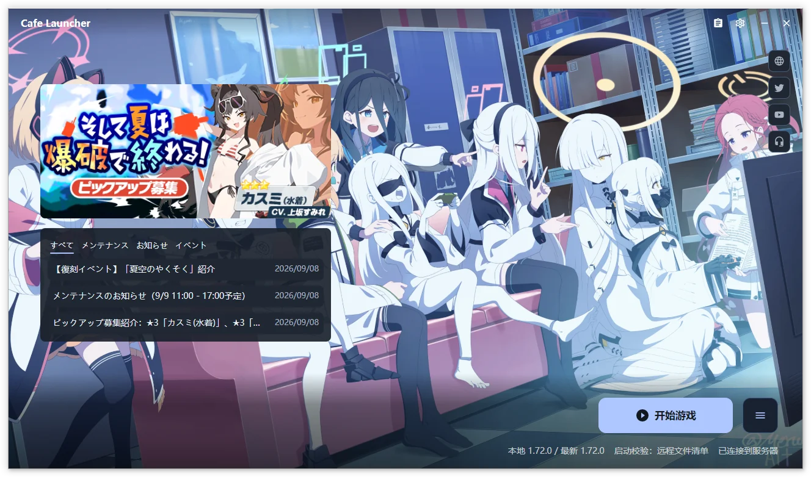

# Cafe Launcher

Cafe Launcher installs and maintains Blue Archive JP. Reuse a directory created by the official launcher, or download, update, repair, and launch a new installation.

[Download](https://github.com/bluearchive-cafe/Cafe.Launcher.Avalonia/releases) · [Installation and first run](/en/cafe-launcher/installation) · [Troubleshooting](/en/cafe-launcher/faq)

> [!IMPORTANT]
> This community project is not affiliated with Nexon, Nexon Games, Yostar, or the official Blue Archive team. It does not modify or inject code into the game process.

Shared screenshots show the Chinese interface and may come from earlier versions. Follow the text for current controls and settings groups.

## Start here  {#start-here}

| Your goal | Guide |
| --- | --- |
| Download, reuse existing files, or install for the first time | [Installation and first run](/en/cafe-launcher/installation) |
| Change paths, networking, backgrounds, colors, or motion | [Settings](/en/cafe-launcher/settings) |
| Download, repair, launch, or use the tray | [Game operations](/en/cafe-launcher/operations) |
| Choose Chinese-localized resources and enter a UID | [Resource Panel](/en/cafe-launcher/resource-panel) |
| Remove game files, the launcher, or local data | [Uninstall and data](/en/cafe-launcher/uninstall) |
| Troubleshoot, export logs, and report a problem | [FAQ](/en/cafe-launcher/faq), [feedback](/en/cafe-launcher/feedback) |

## Features  {#features}

Availability depends on the platform. Windows is supported; macOS and Linux limitations are listed below.

### Game management  {#game-management}

Install, incrementally update, repair, launch, and uninstall from the main window. Launch verification checks file existence and size; repair checks file contents using CRC64. Game uninstall removes the whole game directory, with its scope and path shown before confirmation.

### Downloads and networking  {#downloads-and-networking}

Choose Official or Cafe download sources, use up to 10 concurrent transfers, limit speed, pause, and resume. Normal exit preserves a recoverable download task; actively stopping discards the task record. See [network settings](/en/cafe-launcher/settings#download-and-network).

### Desktop experience  {#desktop-experience}

Use English, Simplified Chinese, Traditional Chinese, or Japanese; system/light/dark themes; wallpaper-derived colors; custom images; and local video backgrounds on Windows x64. Preview appearance changes, then save or discard them.

A system tray, local log viewer, and ZIP diagnostics export are included. Windows can download and verify launcher updates in-app; macOS and Linux use manual installation from the release page.

### Chinese localization resources  {#chinese-localization-resources}

The Cafe download source provides game text, main-story Chinese voice, and image/video resources. Toggle each in the [Resource Panel](/en/cafe-launcher/resource-panel) using an eight-uppercase-letter localization UID, distinct from the numeric UID shown in the game.

## Platform status  {#platform-status}

| Platform | Architecture | Scope |
| --- | --- | --- |
| Windows 10 1809+ / Windows 11 | x64 | Supported, including game launch, video backgrounds, and in-app updates |
| macOS | Apple Silicon | Experimental; install, update, and repair; no game launch |
| Linux | x64 | Experimental; game launch through separately installed UMU / Proton or Wine |

Packages include the .NET Runtime. Linux anti-cheat compatibility depends on the runner, Proton build, drivers, and game version; historical hardware testing does not establish support for every combination. See [Compatibility runtime](/en/cafe-launcher/settings#compatibility-runtime-linux-only).

## Project links  {#project-links}

- [Source and Issues](https://github.com/bluearchive-cafe/Cafe.Launcher.Avalonia)
- [Downloads and release notes](https://github.com/bluearchive-cafe/Cafe.Launcher.Avalonia/releases)
- [Privacy policy (Chinese)](https://github.com/bluearchive-cafe/Cafe.Launcher.Avalonia/blob/main/PRIVACY.md)
- [Third-party licenses](https://github.com/bluearchive-cafe/Cafe.Launcher.Avalonia/blob/main/THIRD-PARTY-NOTICES.md)
