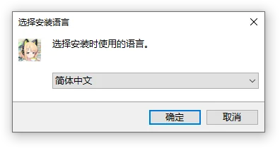
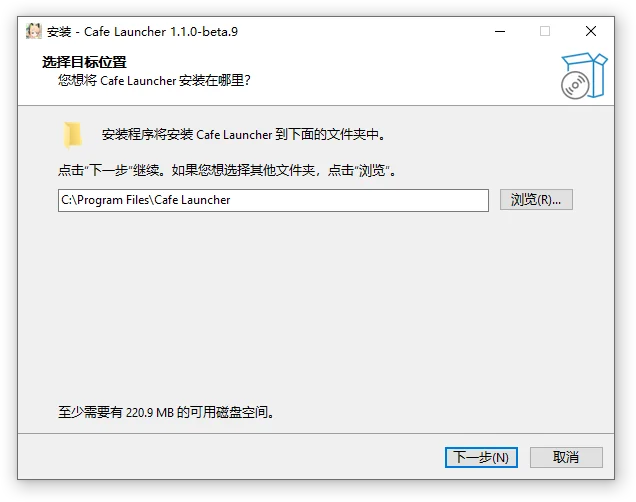
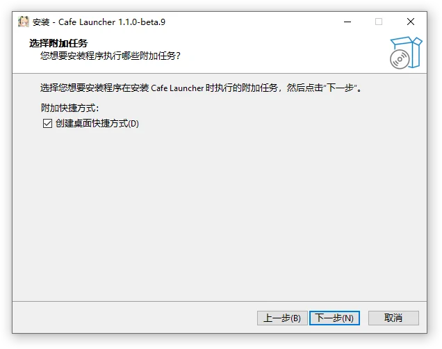
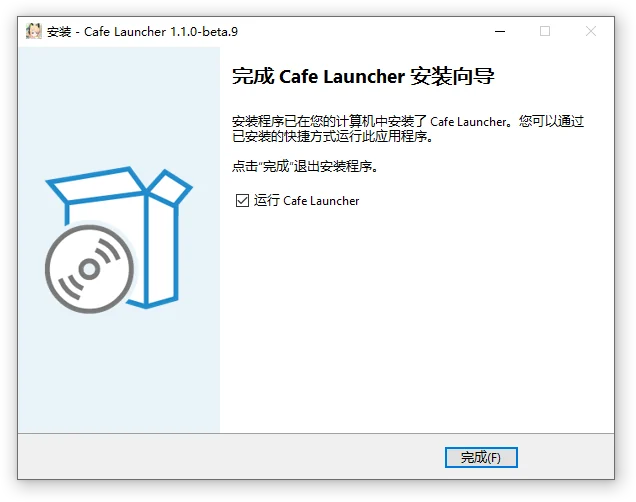
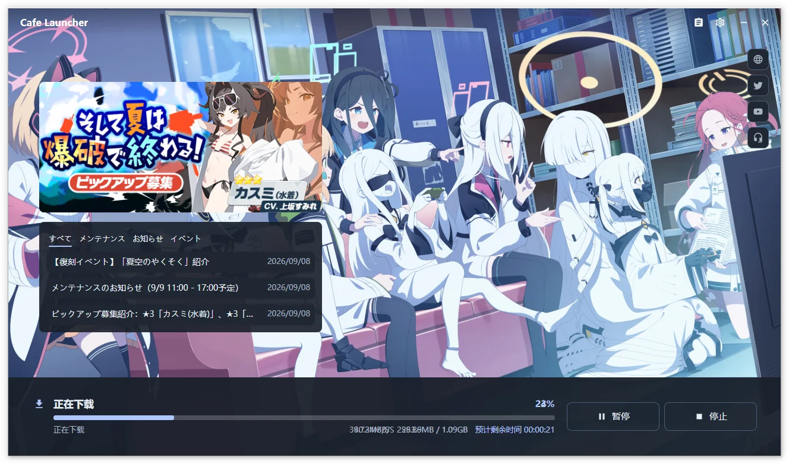

# Installation and First Run  {#installation-and-first-run}

Follow these five steps to prepare the launcher and detect or install the game. You can reuse an existing game without uninstalling the official launcher.

## 1. Check your platform  {#_1-check-your-platform}

| Platform | Packages |
| --- | --- |
| Windows 10 1809+ / Windows 11 x64 | Installer, portable ZIP |
| macOS Apple Silicon | .app ZIP |
| Linux x64 | DEB, RPM, Arch package, AppImage, tar.gz |

Packages include the .NET Runtime. Confirm that the game directory is writable, disk space is sufficient, and your network can reach the selected download source.

> [!WARNING]
> macOS and Linux builds are experimental. macOS cannot launch the game. Linux requires separately installed UMU / Proton or Wine, and anti-cheat compatibility is not guaranteed for your setup.

## 2. Download the right package  {#_2-download-the-right-package}

Open [Releases](https://github.com/bluearchive-cafe/Cafe.Launcher.Avalonia/releases) and download the complete package:

| Filename | Use |
| --- | --- |
| `Cafe.Launcher_v*_setup.exe` | Standard Windows installation |
| `Cafe.Launcher_v*_win-x64.zip` | Portable Windows build |
| `Cafe.Launcher_v*_osx-arm64.zip` | Apple Silicon Mac |
| `Cafe.Launcher_v*_linux-x64.deb` | Debian, Ubuntu, and related distributions |
| `Cafe.Launcher_v*_linux-x64.rpm` | Fedora, openSUSE, and related distributions |
| `Cafe.Launcher_v*_linux-x64.pkg.tar.zst` | Arch Linux |
| `Cafe.Launcher_v*_linux-x64.AppImage` | Run on Linux without installation |
| `Cafe.Launcher_v*_linux-x64.tar.gz` | Manual Linux deployment |

Older packages may use the `Cafe.Launcher.Avalonia` prefix. Choose the latest stable release for everyday use; `beta` and other prerelease labels identify testing builds.

## 3. Install the launcher  {#_3-install-the-launcher}

Use the instructions for your package. Exit the old version before manually upgrading. Application files, game files, and user data are stored separately.

### Windows installer  {#windows-installer}

1. Run the installer and select English, Simplified Chinese, or Japanese. This choice affects only the installer; choose the launcher language during setup.
2. Accept the administrator prompt and check the destination, normally `C:\Program Files\Cafe Launcher`.
3. Optionally create a desktop shortcut, finish, and run Cafe Launcher.

Installation, upgrades, and uninstallation apply to all users and require administrator permission. Installing over an existing version preserves separate user data and game files.

::: details Installer screenshots (Chinese)

:::

### Windows portable build  {#windows-portable-build}

Extract the whole ZIP, then run `Cafe.Launcher.exe`. Do not run from an archive preview. Keep all accompanying dependencies and the video runtime.

The portable build has no standard uninstall entry. Settings and logs still use the system user data directory. Verified in-app updates work for both portable and installed builds. For manual replacement, exit first and replace the complete application directory.

### macOS

Extract `osx-arm64.zip` and move Cafe Launcher.app to Applications. This build requires Apple Silicon. Alternatively, download `cafe-launcher.rb` from the same release and run `brew install --cask ./cafe-launcher.rb` with Homebrew installed; the cask installs its mpv dependency. The ZIP already includes the video runtime.

It can install, update, and repair game files; launching the Windows game is currently unavailable.

### Linux

| Package | Installation or launch |
| --- | --- |
| DEB / RPM | Use the corresponding distribution package manager to install the libmpv dependency automatically |
| Arch package | `sudo pacman -U ./Cafe.Launcher_v<version>_linux-x64.pkg.tar.zst` with the actual filename |
| AppImage | Grant executable permission, then run |
| tar.gz | Extract and run `Cafe.Launcher` |

System packages provide the `cafe-launcher` command. The bundled portable Linux player requires glibc 2.35 and a libstdc++ providing `GLIBCXX_3.4.29`; on older systems it can fall back to a compatible system libmpv, or otherwise to the static background. If no window appears, launch from a terminal and install missing graphics, font, or other system libraries reported there.

Packages do not install Wine, UMU, or Proton. Prepare a [compatibility runtime](/en/cafe-launcher/settings#compatibility-runtime-linux-only) before launching the game. Linux packages and AppImage suggest `YostarGames/BlueArchive_JP` for Blue Archive or `YostarGames/StellaSora_CN` for Stella Sora under your home directory. Confirm each game's location when installing it for the first time.

## 4. Complete first-time setup  {#_4-complete-first-time-setup}

| Step | What to confirm |
| --- | --- |
| Language and theme | Interface language and system, light, or dark theme |
| Proxy | Automatic detection, direct connection, or system proxy |
| Confirm your settings | Review and finish, or return to edit an earlier step |

The wizard has only these three steps and configures global preferences. It does not select a game directory or source. Choose Blue Archive JP or Stella Sora CN in the game navigation; the first Install Game action for each entry asks for its directory. Blue Archive defaults to Cafe on Chinese systems and Official elsewhere; Stella Sora offers Official only. Stable builds default to the stable update channel, and prerelease builds to beta.

Skipping setup or pressing Esc asks for confirmation before applying defaults. Settings can be changed later.

## 5. Detect or install the game  {#_5-detect-or-install-the-game}

Select the correct game entry first. Use its Select Installed Game action or Settings → Game to choose `BlueArchive_JP` for Blue Archive or `StellaSora_CN` for Stella Sora. The launcher reads `manifest.json` and `game-launcher-config.json` and detects installations with valid identity and format without downloading the whole game again. Incomplete files are filled in against the selected manifest; another game's state is not accepted as this game's installation.

For a new installation, select **Install Game** in the chosen entry and confirm its installation directory. Cancelling the directory picker starts no task. Wait for download and verification; pause and resume are available, and you can switch entries to see the background task summary.

Screenshots show the Chinese interface and may be from an earlier version. Continue with [Game operations](/en/cafe-launcher/operations) or the [Settings reference](/en/cafe-launcher/settings).
