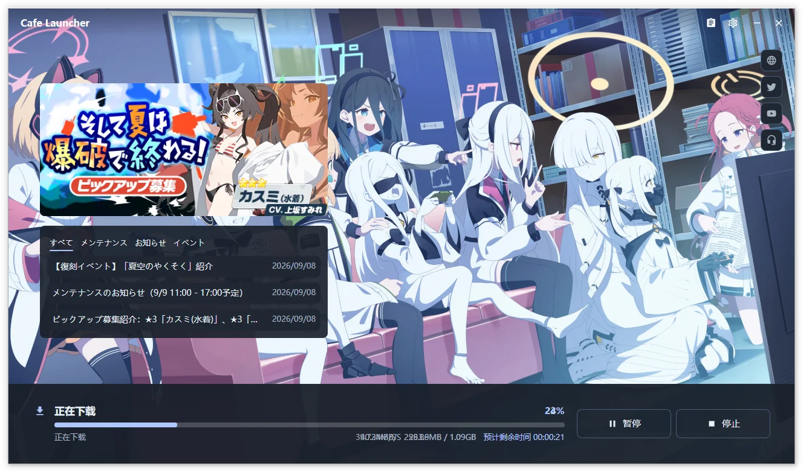
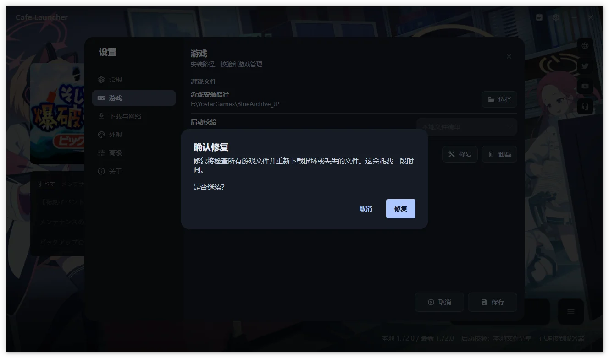
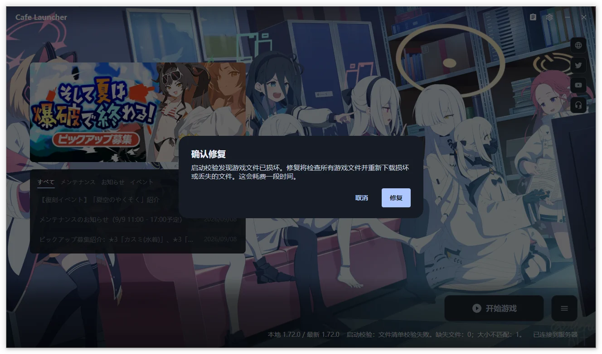
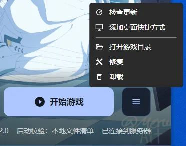
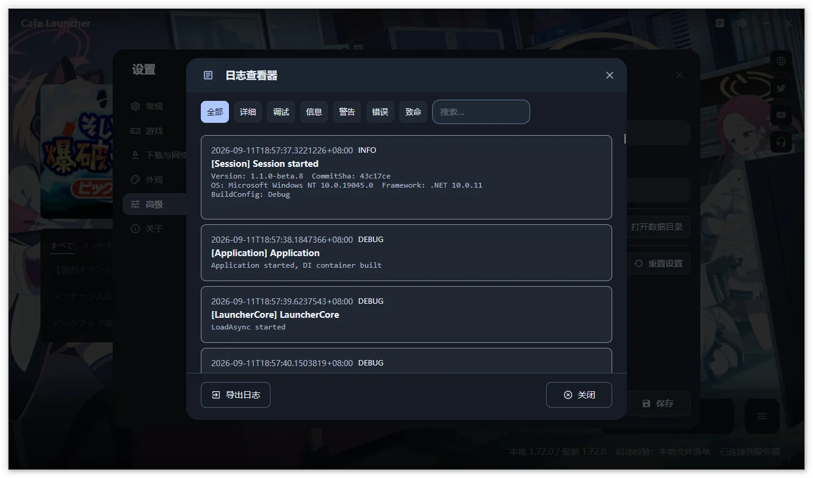
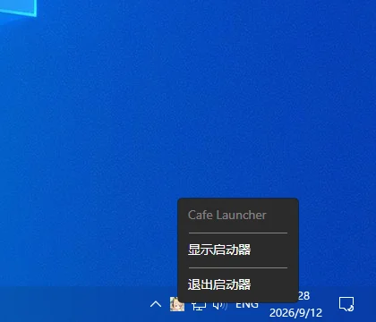

# Game Operations  {#game-operations}

The main action changes between Install Game, Update Game, and Start Game based on installation and version status. The floating game rail on the left provides game selection, background-task returns, and Settings; the current game name appears at the lower left. The lower-right action card stays anchored to the bottom and becomes wider for installation, tasks, and errors. Task details can expand, and longer content scrolls inside the card. Errors remain on the card with Retry when available and View Log; another game's failure has a return entry in the rail. The upper-right information card combines banners, three news items per category with Expand/Collapse, and social links. When a smaller window or expanded task details leave less room, banners and notices collapse while the news list remains accessible. Failed information loading does not block game actions.

Select Blue Archive JP or Stella Sora CN in the game navigation first. Installation state, notices, runtime settings, and actions belong to that entry. Switching entries keeps the other game's task running. Its background summary identifies the game and returns to its progress; completion and failure notifications also name the game.

Only one install, update, repair, or uninstall can run across the launcher. Pausing keeps the task slot, and Stop keeps it until cleanup and refresh finish. Blocked requests are reported immediately and are not queued. A confirmation does not reserve the slot; admission is checked again after confirmation. Unsaved settings or an open modal prevent switching entries.

## Install and update  {#install-and-update}

1. Select **Install Game** or **Update Game** for the chosen entry. Its first installation asks for that game's directory before fetching the manifest and planning transfers.
2. Wait for downloads. Files are written to .tmp files first and resumed when supported.
3. After CRC64 verification, the launcher updates the local manifest and game configuration.

Canceling the first-install directory picker starts no download and leaves both games' saved configurations unchanged. Use Game Settings → Installation and Maintenance → Select Installed Game to recognize an existing installation.

The progress area shows percentage, speed, sizes, and remaining time; the status area identifies the source.

| Action | Result |
| --- | --- |
| Pause | Suspend transfers and retain current progress |
| Resume | Continue using available temporary files |
| Stop | Confirm cancellation and discard this task's recovery record |
| Normal exit | Wait for cleanup and preserve a recovery record for next launch |
| Speed limit | Adjust in [network settings](/en/cafe-launcher/settings#download-and-network) |

Selecting **Stop** discards this task's recovery record; exiting the launcher preserves it. Recovery requires matching game version, manifest, directory, and download source; old tasks are not applied to a different installation.

Recovery records belong to individual games. Startup only attempts to resume the last-viewed entry. For another entry, select it and start installation or update to recheck and reuse existing files. Normal exit waits for all game tasks to finish cleanup; an explicit Stop discards only that task's record. Wait for an executing uninstall to finish before exiting. Minimizing or switching games does not stop downloads.

Disk checks credit resumable .tmp bytes in the current plan; final verification is still required. Waiting for a response or receiving no data for 60 seconds triggers network retry. A large file that keeps receiving data has no fixed total transfer deadline.

## Repair  {#repair}

1. Close the game.
2. Choose **Repair** under Game Settings → Installation and Maintenance or the [game menu](#game-menu), and check the target game in the confirmation.
3. Confirm and wait for CRC64 checks against the remote manifest; missing or mismatched files are downloaded again.
4. Review the result. On failure, use View Log or [export diagnostics](/en/cafe-launcher/feedback).

Launch verification checks only existence and size. Use repair for content integrity and after changing download sources so files match the new manifest.

## Launch the game  {#launch-the-game}

Select **Start Game** to run the configured verification and launch the entry in the local installation state. Successful launch minimizes to tray by default; change this under Settings → General.

Repeated launch requests, including shortcut requests, are rejected while this game is still starting or refreshing. You can launch this game while another game downloads or repairs. If this game has a file task, finish it or stop and wait for cleanup first. After-launch behavior is saved separately for each game. If Exit launcher was selected while another game still has a file task, the launcher reports this and minimizes instead, keeping that task running.

| Session status | Meaning |
| --- | --- |
| Game starting | Waiting for the runner and game process |
| Game running | Game process confirmed |
| Game exited | Session ended; an attributable exit code is shown when available |
| Launch failure | No successful running state; the main window is restored with an error |

The status row is hidden without a session. Normal exit updates the text without another notification. Wine / Proton may not provide an attributable exit code; an early runner exit or damaged environment can cause launch failure.

Missing or mismatched files lead to a repair prompt:

Linux requires a [compatibility runtime](/en/cafe-launcher/settings#compatibility-runtime-linux-only). Game launch is unavailable on macOS.

## Game menu  {#game-menu}

When ready, use the menu control beside **Start Game**. The main part still launches directly. Both compact and hidden status-panel layouts provide this control.

| Action | Purpose |
| --- | --- |
| Check for Updates | Refresh the remote game version and main action |
| Add Desktop Shortcut | Create a launcher entry bound to this game: Windows `.lnk`, Linux `.desktop`, or macOS `.command`; platform game-launch limitations still apply |
| Open Game Directory | Open the current folder |
| Repair | Check CRC64 integrity and restore files |
| Uninstall | Remove the whole game directory after confirmation |

These maintenance actions are also available under Game Settings → Installation and Maintenance. If Settings has changes, keep editing or discard the draft to continue the action. Canceling a repair opened from the menu, including with Esc, returns focus to the launch control.

This screenshot shows an older menu. The current control is beside Start Game.

New game shortcuts enter Cafe Launcher with an explicit target: `--launch-game --game-id blue-archive-jp` or `--launch-game --game-id stella-sora-cn`. They do not require a game-side `run.bat`. Existing Windows shortcuts that directly invoke a script are not rewritten automatically. The legacy bare `--launch-game` always means Blue Archive. Unknown IDs are rejected rather than inferred from the current page.

If the launcher is already running, the new shortcut forwards its target to that instance. An open confirmation, unsaved settings, or a file task for the same game produces a rejection; it does not close a dialog, discard a draft, or schedule a launch for later.

## Uninstall the game  {#uninstall-the-game}

Close the game, choose **Uninstall** from Game Settings → Installation and Maintenance or the game menu, and review the target game, full path, estimated size, and optional managed compatibility-environment cleanup before confirming.

If you switch games before the confirmation appears, return to the original game and choose Uninstall again.

> [!WARNING]
> The whole game directory is deleted, including game-downloaded resources and files you added. Installation state, recovery records, and desktop shortcuts are also removed. Back up anything needed first.

The panel shows scanning, deletion progress, and results, including paths that could not be removed. Keep the launcher open; minimizing is allowed. A custom Prefix outside the game directory and selected managed subtree is preserved.

Launcher removal is separate. See [Uninstall and data](/en/cafe-launcher/uninstall).

## Log viewer  {#log-viewer}

Open Settings → Advanced → **View Log** to browse, search, and filter current and rotated logs.

Records load in batches. Filters and search apply only to loaded records. For a complete issue time range, [export logs](/en/cafe-launcher/feedback#export-logs).

The viewer can open over Settings, with Export Logs opening another layer above it. Esc returns through these layers and preserves the Settings draft. View Log on an uninstall failure closes the result before opening the viewer; closing the viewer returns to the home screen.

## System tray  {#system-tray}

With minimize-to-tray close behavior, the close button hides the window and keeps the process running. The tray can show the main window, start the game, open Settings, or exit completely.

The launch item shows starting/running session status. Actions needing confirmation or Settings restore the main window. Running the launcher again activates the existing instance. One instance owns each data directory, including across Linux login sessions.

Screenshots show Chinese and may be from earlier versions; follow the text for current controls.
