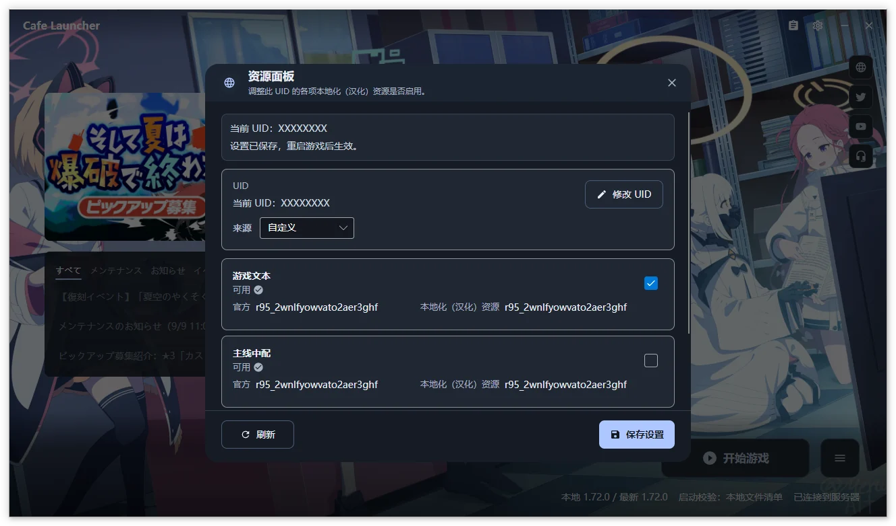

# Resource Panel  {#resource-panel}

Read and save server-side resource preferences for a localization UID. Open the panel with the clipboard icon left of the title-bar settings gear.

> [!IMPORTANT]
> This requires the Cafe download source. On Official, the panel offers a source switch. [Repair the game](/en/cafe-launcher/operations#repair) afterward when prompted so files match the new manifest.

## UID

Use the **eight-uppercase-letter localization UID**, distinct from the numeric in-game UID. `ABCDEFGH` illustrates the format.

| Source | Use |
| --- | --- |
| Automatic (default) | Read the local Cookie Library; on Windows, `AppData/LocalLow/YostarJP/BlueArchive/Cookies/Library` under the user profile; Linux reads the selected compatibility prefix |
| Custom | Enter a UID manually, then use Change UID to edit it |

If reading fails, enter the UID in the displayed field and select **Save UID**. If not yet generated, launch with the Cafe download source first, then refresh. The panel explains this generation requirement.

The source and manual UID are stored locally. Cookie reading locates the relevant UID; the Cookie file is not uploaded.

## Resource categories  {#resource-categories}

| Category | Content |
| --- | --- |
| Game text | Chinese story, interface, item, and other text |
| Main-story Chinese voice | Chinese dubbing for the main story |
| Images and video | Chinese-localized image and video resources |

Each has a separate switch and official/localized versions. Matching versions show Available; mismatches show Pending maintenance. Mismatched resources remain selectable but may not match the current game. Wait during loading or Refresh after failure.

## Save and apply  {#save-and-apply}

1. Confirm the displayed localization UID is the intended one.
2. Change resource switches.
3. Select **Save Settings** and wait for success in the status strip.
4. Restart the game to apply server preferences.

Refresh reads current server state and versions. Saving requires networking and writes the switches for that UID; it does not directly modify local game files. Disable a category and save to use its original resources.

Changing the local UID does not delete the old server configuration. See the [privacy policy (Chinese)](https://github.com/bluearchive-cafe/Cafe.Launcher.Avalonia/blob/main/PRIVACY.md) for data requests. Screenshots show Chinese and may come from earlier versions.
