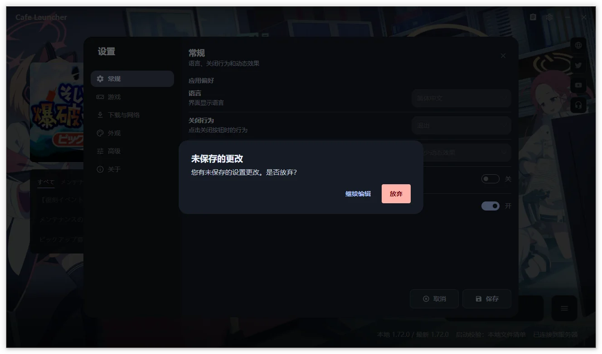
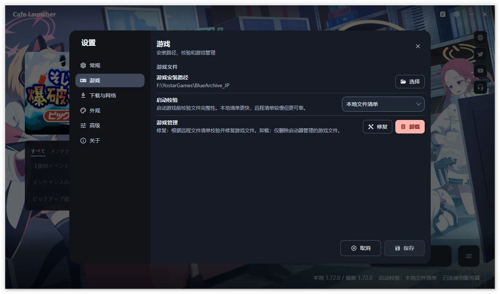
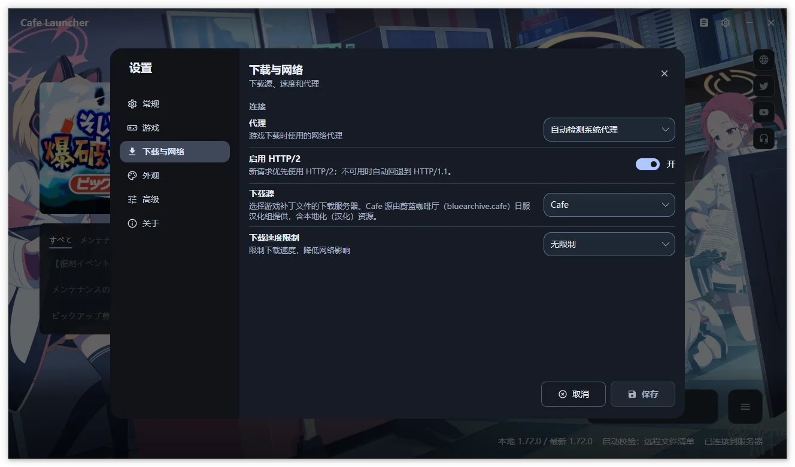
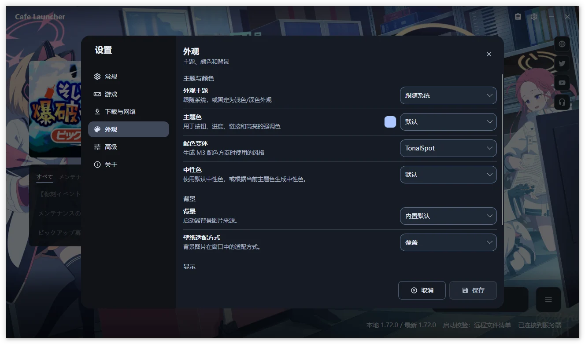
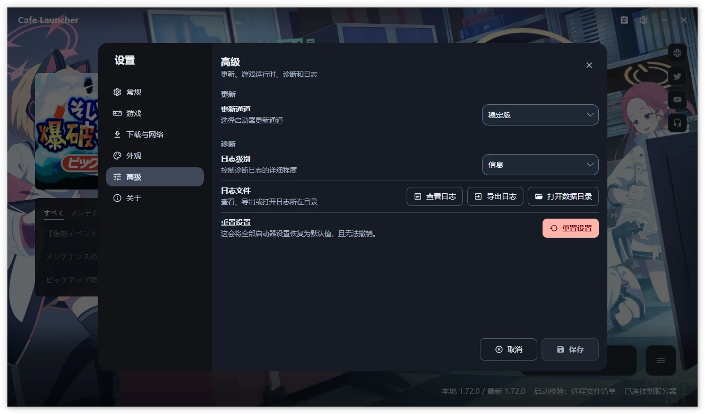
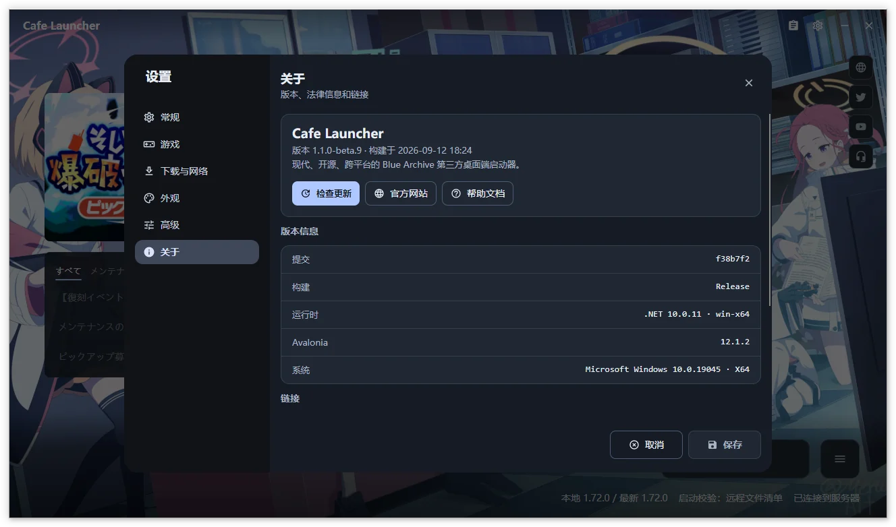

# Settings Reference  {#settings-reference}

Open the gear at the top right of the main window. Settings has six categories: General, Game, Download & Network, Appearance, Advanced, and About.

Unless explicitly described as immediate, changes remain a draft until you choose **Save** to write them to `settings.json`. Closing with unsaved changes asks whether to discard them.

## General  {#general}

### App preferences  {#app-preferences}

| Setting | Choices | Purpose |
| --- | --- | --- |
| Language | Automatic, English, Simplified Chinese, Traditional Chinese, Japanese | Interface language; Automatic follows the system |
| Close behavior | Minimize to tray, Exit | What the window close button does |
| After game launch | Keep window open, Minimize to tray, Exit launcher | Action after the game is successfully started |
| Motion | Follow system, Full motion, Reduced motion | Animations and automatic banner rotation |
| Remember window position and size | On, Off | Restore window layout at startup |

### Display  {#display}

| Setting | Choices | Purpose |
| --- | --- | --- |
| Status panel | Hidden, Compact | Visibility and detail of the bottom status area |
| Remote content cards | On, Off | Notices and banners; failed cards provide a Retry action |

### Updates  {#updates}

| Setting | Choices | Purpose |
| --- | --- | --- |
| Check for updates at startup | On, Off | Check the selected channel after initialization |
| Update channel | Stable, Beta | Whether launcher updates include prereleases |

Toast notifications are always enabled. Their duration depends on the notification type, and hovering pauses the timer.

## Game  {#game}

| Setting | Choices | Purpose |
| --- | --- | --- |
| Game installation path | Local directory | Normalized to an absolute path ending in `YostarGames/BlueArchive_JP`; use Open Game Directory to view it |
| Launch verification | Local manifest, Remote manifest, None | How files are checked before launch |
| Game management | Repair, Uninstall | Repair missing or corrupt files, or uninstall the entire game directory |

> [!NOTE]
> Choosing a path inside Settings only changes the draft until you save. **Change Path** and selecting an installed game from the main window save immediately and refresh the game state.

### Launch verification  {#launch-verification}

| Mode | Behavior | When to use it |
| --- | --- | --- |
| Local manifest | Check file existence and size against local `manifest.json` | Default and fastest option |
| Remote manifest | Fetch the remote manifest, then check existence and size | If the local manifest may be outdated or damaged |
| None | Attempt to launch directly; status shows verification disabled | Temporarily isolate a verification problem |

Launch verification does not replace a full repair. Use **Repair** to check file contents with CRC64 and download mismatches again.

### Compatibility runtime (Linux only)  {#compatibility-runtime-linux-only}

| Setting | Purpose |
| --- | --- |
| Runtime | Auto, Windows (Native), UMU / Proton (Experimental), or Wine (Experimental) |
| Runner path | Custom `umu-run` or `wine` executable; leave blank for automatic detection |
| Prefix path | Leave blank for separate prefixes managed by the launcher for each runner |
| Proton path | Custom Proton build for UMU; leave blank for UMU's automatic selection |
| Runtime status | Read-only detection result, such as available, unavailable, or not found |

Linux game launch is experimental. XIGNCODE3 was verified on Arch + UMU 1.4.4 + UMU-Proton 10.0-4 with the game on NTFS3; other combinations remain unverified.

Before launch, the launcher checks that the prefix is writable, its mount allows execution, and its filesystem supports symbolic links. Blocking issues include suggestions for fixing them.

## Download and Network  {#download-and-network}

| Setting | Choices | Purpose |
| --- | --- | --- |
| Proxy | Auto-detect, Direct, System proxy | Network proxy mode |
| Enable HTTP/2 | On, Off | Prefer HTTP/2 for new requests, falling back to HTTP/1.1 |
| Download source | Official, Cafe | Server used for game patch files |
| Download speed limit | Unlimited, 1, 5, 10, 25, 50 MB/s | Limit download bandwidth |

- **Auto-detect** uses the launcher's default network behavior.
- **Direct** avoids an explicit proxy.
- **System proxy** prefers explicitly configured system proxies, falling back to automatic system proxy discovery. On Linux, it reads GNOME proxy settings.

Fake-IP DNS answers in IPv4 `198.18.0.0/15` and IPv6 `fc00::/7` are accepted on direct connections. If connecting still fails, the error identifies Fake-IP as a possible cause and suggests automatic proxy detection, TUN mode, or disabling Fake-IP DNS in your proxy software.

After changing sources for a playable installation, the launcher prompts you to repair against the new source's manifest. The Cafe source is provided by the BlueArchive.Cafe JP Chinese localization team and also enables the [Resource Panel](/en/cafe-launcher/resource-panel).

## Appearance  {#appearance}

### Theme and colors  {#theme-and-colors}

| Setting | Choices | Purpose |
| --- | --- | --- |
| Theme | System, Light, Dark | Follow the system or select a fixed appearance |
| Accent color | Default, System, From wallpaper, Custom | Color for buttons, progress, links, and highlights |
| Extraction algorithm | M3 Celebi + Score, Wu, Wsmeans, Octree (Legacy) | Wallpaper seed-color extraction; shown for wallpaper-derived accents |
| Color variant | TonalSpot, Vibrant, Expressive, Content, Fidelity, Neutral, Rainbow, Monochrome | Style of the generated M3 scheme |
| Neutral colors | Default, Follow accent | Default neutrals or neutrals generated from the accent |
| Wallpaper palette | Colors extracted from the current background | Select a seed color when using a wallpaper-derived accent |

### Background  {#background}

| Setting | Choices | Purpose |
| --- | --- | --- |
| Background | Bundled, Remote, Custom | Image source |
| Wallpaper fit | Fill, Fit, Cover | How the image fits the window |
| Background fill color | Custom color | Color around the wallpaper in Fit mode |
| Custom background | Choose image, Choose folder, Clear | Local image or folder; shown for Custom backgrounds |

The bundled wallpaper comes from a Pixiv illustration. Attribution and licensing notes appear on the About page.

## Advanced  {#advanced}

### Diagnostics  {#diagnostics}

| Setting | Choices | Purpose |
| --- | --- | --- |
| Log level | Verbose, Debug, Information, Warning, Error, Fatal | Amount of diagnostic detail |
| Log files | View Log, Export Logs, Open Data Directory | Browse, export, or locate local logs |

The [log viewer](/en/cafe-launcher/operations#log-viewer) loads records in batches. Search and level filters apply only to loaded records. [Export Logs](/en/cafe-launcher/feedback#export-logs) opens the diagnostics export dialog. For intermittent problems, temporarily increase the log level, reproduce the issue, and export immediately.

### Reset settings  {#reset-settings}

Reset restores all launcher settings to defaults immediately and cannot be undone. You do not need to press Save. Consider exporting logs first if you need a record of the previous configuration.

## About  {#about}

About shows the commit, build, .NET Runtime, Avalonia version, and operating system, along with these shortcuts:

- **Check for Updates** uses the saved channel and proxy settings.
- **Official Website** opens the project website.
- **Help** opens this documentation site.

The links section includes the source repository, release repository, and issue tracker. Legal information includes the privacy policy, original wallpaper artwork, and disclaimer.

On Windows, an available update first shows its release notes. Choose **Download**, wait for the package to be checked against the release's SHA-256 checksum list, then choose **Restart to Update** to exit, apply it, and reopen automatically. If the checksum list or required package is missing, the launcher opens the release page instead of running an unverified file.

macOS and Linux use **Go to Release Page**. Download and install those updates manually.
