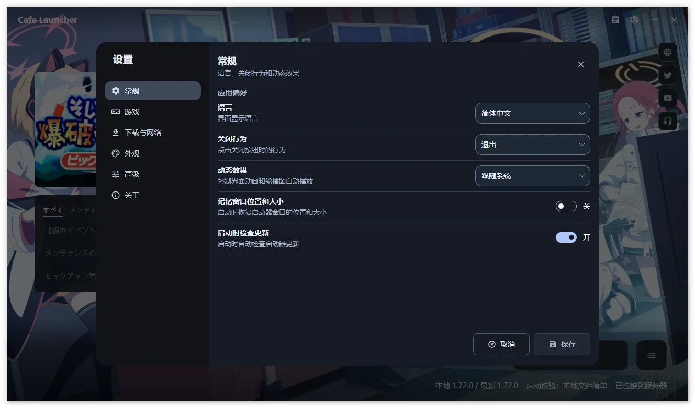

# Settings Reference  {#settings-reference}

Open Settings with the gear in the upper-right corner. Six categories cover General, Game, Download and Network, Appearance, Advanced, and About. Select a category, edit, then choose Save.

Edits form a draft. Appearance previews immediately but persists only on save; discarding restores it. Closing or pressing Esc with changes asks whether to discard. Reset, immediate main-window path actions, and Resource Panel saves are separate operations described below.

Shared screenshots show Chinese and may come from earlier versions; follow the text for current groups and controls.

## General  {#general}

Configure application preferences, main-window information, and launcher updates. Motion is under [Appearance](#theme-and-motion).

### App preferences  {#app-preferences}

| Setting | Choices | Purpose |
| --- | --- | --- |
| Language | Automatic, English, Simplified Chinese, Traditional Chinese, Japanese | Interface language; Automatic follows the system |
| Close behavior | Minimize to tray, Exit | What the window close button does |
| After game launch | Keep window open, Minimize to tray, Exit launcher | Action after the game is successfully started |
| Remember window position and size | On, Off | Restore window layout at startup |

Closing the window and behavior after game launch are independent. Both default to minimizing to tray. Window position and size memory is off by default.

### Display  {#display}

| Setting | Choices | Purpose |
| --- | --- | --- |
| Status panel | Hidden, Compact | Visibility and detail of the bottom status area |
| Remote content cards | On, Off | Notices and banners; failed cards provide a Retry action |

Compact status and remote content are enabled by default. Failed remote content can be retried on its card.

### Updates  {#updates}

| Setting | Choices | Purpose |
| --- | --- | --- |
| Check for updates at startup | On, Off | Check the selected channel after initialization |
| Update channel | Stable, Beta | Whether launcher updates include prereleases |

Startup checks are on by default. Stable builds default to stable; prerelease builds default to beta. Channels affect launcher releases, while game updates follow game versions.

Toasts are always enabled, use fixed durations by type, and pause their timer on pointer hover.

## Game  {#game}

| Setting | Choices | Purpose |
| --- | --- | --- |
| Game installation path | Local directory | Normalized to an absolute path ending in `YostarGames/BlueArchive_JP`; use Open Game Directory to view it |
| Launch verification | Local manifest, Remote manifest, None | How files are checked before launch |
| Game management | Repair, Uninstall | Repair missing or corrupt files, or uninstall the entire game directory |

Path selection here edits the draft and requires Save. Change Path and Select Installed Game in the main window save immediately and refresh status.

See [Game operations](/en/cafe-launcher/operations) for repair and removal. Uninstall includes files outside the manifest; review the full path first.

### Launch verification  {#launch-verification}

| Mode | Behavior | When to use it |
| --- | --- | --- |
| Local manifest | Check file existence and size against local `manifest.json` | Default and fastest option |
| Remote manifest | Fetch the remote manifest, then check existence and size | If the local manifest may be outdated or damaged |
| None | Attempt to launch directly; status shows verification disabled | Temporarily isolate a verification problem |

Local manifest is the default. Both manifest modes check existence and size; use CRC64 repair for damaged contents. Verification allows launch when a remote manifest cannot be obtained; this is not evidence of full integrity.

### Compatibility runtime (Linux only)  {#compatibility-runtime-linux-only}

| Setting | Purpose |
| --- | --- |
| Runtime | Auto, Windows (Native), UMU / Proton (Experimental), or Wine (Experimental) |
| Runner path | Custom `umu-run` or `wine` executable; leave blank for automatic detection |
| Prefix path | Leave blank for separate prefixes managed by the launcher for each runner |
| Proton path | Custom Proton build for UMU; leave blank for UMU's automatic selection |
| MangoHud | Off by default; enables the Vulkan / DXVK performance overlay for Wine / UMU launches on Linux; install MangoHud separately |
| Runtime status | Read-only detection result, such as available, unavailable, or not found |

Runtime selection defaults to Auto. Install the compatibility layer separately. Leaving Prefix blank uses separate launcher-managed directories per runner. Before launch, the launcher checks writability, mount execution permissions, symlink support, and related conditions and offers guidance on failure.

Historical hardware testing includes Arch Linux + UMU 1.4.4 + UMU-Proton 10.0-4 with game files on NTFS3. This is one tested combination, not a guarantee for other setups or later anti-cheat versions.

MangoHud is off by default and requires a separately installed Vulkan layer. It affects Linux Wine / UMU game child processes for Vulkan / DXVK; no automatic installation or OpenGL injection is provided.

## Download and Network  {#download-and-network}

| Setting | Choices | Purpose |
| --- | --- | --- |
| Proxy | Auto-detect, Direct, System proxy | Proxy for game downloads, update checks, remote images, and other launcher requests |
| Enable HTTP/2 | On, Off | Prefer HTTP/2 for new requests, falling back to HTTP/1.1 |
| Download source | Official, Cafe | Server used for game patch files |
| Download speed limit | Unlimited, 1, 5, 10, 25, 50 MB/s | Limit download bandwidth |

Defaults are automatic proxy detection, HTTP/2 enabled, and unlimited speed. Chinese system languages initially choose Cafe; other languages choose Official.

| Proxy mode | Behavior |
| --- | --- |
| Automatic system proxy | Runtime system proxy detection |
| Direct connection | Explicitly bypass every proxy |
| System proxy (configured first) | Prefer an explicit system proxy, otherwise automatic detection; Linux reads GNOME settings |

Saved proxy and HTTP/2 preferences apply when later network clients are acquired. Manual update checks also use saved values. Repair when prompted after switching sources to match the new manifest.

With Clash / mihomo Fake-IP, direct DNS results in IPv4 `198.18.0.0/15` or IPv6 `fc00::/7` are not rejected solely for being in those ranges. If connection still fails, try automatic proxy detection or review the proxy's TUN / Fake-IP settings.

## Appearance  {#appearance}

Groups follow Theme and motion → Background → Theme colors. Changes preview immediately, persist on Save, and restore previous backgrounds, colors, volume, and mute state on discard.

### Theme and motion  {#theme-and-motion}

| Setting | Choices | Purpose |
| --- | --- | --- |
| Theme | System, Light, Dark | Follow the system or select a fixed appearance |
| Motion | Follow system, Full motion, Reduced motion | Animations, automatic banner rotation, and video background playback; moved here from General |

Theme and motion follow system preferences by default. Full motion honors your explicit in-app selection. Reduced motion stops spatial transitions, automatic banner rotation, and video playback.

### Background  {#background}

| Setting | Choices | Purpose |
| --- | --- | --- |
| Background | Bundled, Remote, Custom | Background source; Custom supports images and local video |
| Current Background | Source name, file path, and thumbnail | Bundled and Remote show source names; hover for the remote URL, or see the selected custom file's path |
| Custom background | Choose Image or Video, Choose folder, Clear | Shown for Custom backgrounds; folders select a supported file at random on refresh without scanning subfolders |
| Wallpaper fit | Fill, Fit, Cover | How the image or video fits the window |
| Background fill color | Custom color | Shown only in Fit mode, to fill the area around the background |
| Video background volume | 0–100%, default 0 | Shown for videos; Mute retains the selected volume and unmuting restores it |

The bundled background is the default. Image formats: .png, .jpg, .jpeg, .bmp, .webp. Video formats: .mp4, .mkv, .webm. Folder selection randomly chooses a supported file at that level only. Volume, mute, fit, and window-size changes do not choose another file.

Video playback requires Windows x64 and the included runtime. Other platforms or playback failures show the bundled static fallback and a notice. Playback pauses while minimized, hidden to tray, or using reduced motion and resumes when visible and motion is allowed. Volume defaults to 0; mute defaults to off. You can adjust retained volume while muted.

Thumbnails prefer embedded MP4 cover art, otherwise the first frame, with a video marker. Colors use the original cover or frame and do not change during playback. Media stays local and is not uploaded. See About for bundled artwork attribution.

### Theme colors  {#theme-and-colors}

| Setting | Choices | Purpose |
| --- | --- | --- |
| Accent color | Default, System, From wallpaper, Custom | Color for buttons, progress, links, and highlights |
| Wallpaper palette | Colors extracted from the current background | Shown for wallpaper-derived accents; select a seed color or refresh the palette |
| Custom accent | Custom color | Shown for Custom accents |

The project accent is the default. The wallpaper palette appears only for wallpaper-derived colors; the custom picker appears only for Custom. Select a seed color from the current image or video cover/first frame, or refresh the palette.

### Advanced colors  {#advanced-colors}

Collapsed by default; expand to adjust:

| Setting | Choices | Purpose |
| --- | --- | --- |
| Extraction algorithm | M3 Celebi + Score, Wu, Wsmeans, Octree (Legacy) | Shown for wallpaper-derived accents only |
| Color variant | TonalSpot, Vibrant, Expressive, Content, Fidelity, Neutral, Rainbow, Monochrome | Style of the generated M3 scheme |
| Neutral colors | Default, Follow accent | Default neutrals or neutrals generated from the accent |

Defaults are M3 Celebi + Score, TonalSpot, and default neutrals. Expanding or collapsing changes only the session's interface state, not settings.

## Advanced  {#advanced}

View and export diagnostic information, or reset settings.

### Diagnostics  {#diagnostics}

| Setting | Choices | Purpose |
| --- | --- | --- |
| Log level | Verbose, Debug, Information, Warning, Error, Fatal | Amount of diagnostic detail |
| Log files | View Log, Export Logs, Open Data Directory | Browse, export, or locate local logs |

Release builds default to Information. Temporarily increase to Debug or Verbose if needed, save, reproduce, export, then restore the previous level.

The [log viewer](/en/cafe-launcher/operations#log-viewer) filters only loaded records. [Export logs](/en/cafe-launcher/feedback#export-logs) creates a local ZIP for a selected time range without uploading. Open Data Directory identifies the actual storage location.

### Reset settings  {#reset-settings}

> [!WARNING]
> Reset immediately restores all launcher settings to defaults, requires no further Save, and cannot be undone. Confirm that you no longer need the current configuration.

Export required diagnostic records first if investigating a problem. Reset does not uninstall the game; see [Uninstall and data](/en/cafe-launcher/uninstall).

## About  {#about}

Shows the application version, commit, build configuration, .NET, Avalonia, and platform. It provides launcher update checks, website and help links, source and release repositories, feedback, privacy information, wallpaper attribution, and the disclaimer.

Manual checks use the saved channel and proxy. Windows follows: read release notes → Download → verify against the same release's SHA256SUMS → Restart to Update. A separate helper applies the installer or portable package.

If a verifiable package, checksum, or updater is missing, the dialog explains why and offers Open Release Page. macOS and Linux always use that action for manual installation. Release notes support remote images and links; failed images do not block text or update actions.
